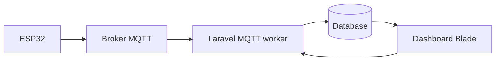

# Smart Socket

Platform pemantauan dan pengendalian dua soket listrik berbasis ESP32, PZEM-004T, MQTT, dan Laravel 13. ESP32 mengirim telemetri listrik/lingkungan, sedangkan dashboard Laravel menampilkan data dan mengirim perintah relay serta threshold.

## Quick start lokal

Dari folder `smartsocket`:

```powershell
composer install
Copy-Item .env.example .env
php artisan key:generate
New-Item -ItemType File -Force database\database.sqlite
npm install
php artisan migrate
php artisan db:seed
php artisan serve
```

Pada terminal lain jalankan `npm run dev` dan `php artisan mqtt:listen --device=<device-uid>`. Isi konfigurasi MQTT di `.env`, lalu buka `http://127.0.0.1:8000`.

## Dokumentasi utama

- [Panduan lengkap instalasi, penggunaan, deployment server, dan firmware](docs/panduan-lengkap.md)
- [Implementasi Laravel](docs/implementasi-laravel.md)
- [Implementasi firmware](docs/implementasi-firmware.md)
- [Ringkasan sistem](docs/ringkasan-sistem.md)
- [Perancangan dan diagram](docs/perancangan.md)
- [Pengujian](docs/pengujian.md)

## Perintah pengembangan

| Perintah | Kegunaan |
|---|---|
| `composer install` | Memasang dependency PHP |
| `npm install` | Memasang dependency frontend |
| `php artisan migrate` | Menjalankan migration database |
| `php artisan db:seed` | Membuat data awal |
| `php artisan serve` | Menjalankan server lokal |
| `npm run dev` | Menjalankan Vite saat development |
| `npm run build` | Build asset produksi |
| `php artisan mqtt:listen` | Menjalankan subscriber MQTT |
| `php artisan test` | Menjalankan test suite |
| `php artisan route:list` | Memeriksa rute aplikasi |

## Arsitektur singkat



Firmware berada di [firmware/smartsocket](firmware/smartsocket). Kredensial WiFi/MQTT firmware disimpan melalui portal lokal dan NVS; kredensial backend disimpan di `.env` atau Settings. Jangan commit `.env`, password, token, atau sertifikat privat.

## Konfigurasi produksi

Gunakan PHP 8.3+, web server dengan document root ke `public/`, HTTPS, database produksi, broker MQTT TLS, serta Supervisor/systemd untuk proses `mqtt:listen`. Detailnya ada pada [panduan lengkap](docs/panduan-lengkap.md).
