# DPPL — Deskripsi Perancangan Perangkat Lunak

**Nama sistem:** Smart Socket IoT Management Platform  
**Instansi/klien:** ⚠️ PERLU KONFIRMASI: nama instansi atau perusahaan.  
**Versi dokumen:** 1.0  
**Tanggal:** 18 Oktober 2026  
**Penyusun:** ⚠️ PERLU KONFIRMASI: nama penyusun.  
**Status:** Rancangan berbasis source code yang tersedia.

> Dokumen ini adalah Dokumen 2 setelah [SKPL](./SKPL.md). Seluruh rancangan dibatasi pada komponen yang terbukti ada di repository. Elemen yang belum tersedia diberi penanda **⚠️ PERLU KONFIRMASI**.

## Daftar Isi

1. [Pendahuluan](#1-pendahuluan)
2. [Arsitektur Sistem](#2-arsitektur-sistem)
3. [Perancangan Data](#3-perancangan-data)
4. [Perancangan Perilaku](#4-perancangan-perilaku)
5. [Perancangan Struktural](#5-perancangan-struktural)
6. [Perancangan Antarmuka](#6-perancangan-antarmuka)
7. [Perancangan Keamanan](#7-perancangan-keamanan)
8. [Perancangan Firmware IoT](#8-perancangan-firmware-iot)
9. [Matriks Keterlacakan](#9-matriks-keterlacakan)
10. [Checklist Kelengkapan](#10-checklist-kelengkapan)

---

## 1. Pendahuluan

### 1.1 Tujuan

DPPL menerjemahkan kebutuhan pada SKPL menjadi rancangan arsitektur, data, perilaku, struktur kelas, antarmuka, keamanan, dan firmware. Dokumen ini menjadi acuan implementasi dan pengujian tanpa menambahkan fitur yang tidak terdapat pada source code.

### 1.2 Lingkup

Rancangan meliputi aplikasi Laravel 13 pada folder `smartsocket/`, worker MQTT, database migration, halaman Blade yang digunakan oleh route web, layanan publish MQTT, firmware ESP32 pada `firmware/smartsocket/`, dan portal konfigurasi pada `config_portal.h`.

### 1.3 Referensi

- [SKPL](./SKPL.md)
- [Panduan lengkap](./panduan-lengkap.md)
- [Perancangan ringkas](./perancangan.md)
- [Routes web](../routes/web.php)
- [MqttService](../app/Services/MqttService.php)
- [MqttListenCommand](../app/Console/Commands/MqttListenCommand.php)
- [Firmware utama](../firmware/smartsocket/smartsocket.ino)
- [Portal konfigurasi](../firmware/smartsocket/config_portal.h)

---

## 2. Arsitektur Sistem

### 2.1 Arsitektur umum

Sistem menggunakan alur berikut:

1. ESP32 membaca PZEM-004T, DS18B20, dan MQ-2.
2. ESP32 menerapkan threshold lokal dan mengendalikan dua relay.
3. ESP32 publish telemetry, status, dan alert ke broker MQTT.
4. Worker `mqtt:listen` pada Laravel subscribe ke topic tersebut.
5. Worker memvalidasi JSON, memperbarui status perangkat, dan menyimpan data melalui Eloquent dalam transaction.
6. Browser meminta halaman atau endpoint Laravel dengan middleware `auth`.
7. Laravel membaca database untuk dashboard, analytics, history, dan notifications.
8. Aksi pengguna diteruskan oleh `MqttService` ke topic command MQTT.

#### Gambar 2.1 Arsitektur sistem

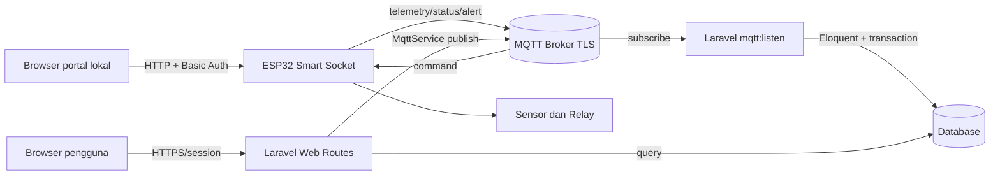

**Penjelasan:** Broker adalah boundary komunikasi. Laravel tidak membaca sensor secara langsung; data masuk melalui MQTT worker. Portal lokal berkomunikasi langsung dengan ESP32 pada jaringan lokal.

### 2.2 Arsitektur aplikasi Laravel

| Lapisan | Komponen | Tanggung jawab |
|---|---|---|
| Routing | `routes/web.php`, `routes/auth.php` | Memetakan URL ke controller dan menerapkan `auth`. |
| Presentation | Blade views pada `resources/views/` | Menampilkan dashboard dan formulir. |
| Controller | `DashboardController`, `AnalyticsController`, `HistoryController`, `SettingsController`, `AboutController`, `ProfileController` | Mengorkestrasi request, validasi, query, dan response. |
| Service | `MqttService`, `NotificationService` | Menyediakan operasi publish MQTT dan kebutuhan notifikasi. |
| Console worker | `MqttListenCommand` | Subscribe MQTT, parse payload, dan menyimpan event. |
| Model | Model Eloquent pada `app/Models/` | Representasi tabel dan relasi. |
| Persistence | migration pada `database/migrations/` | Definisi schema, foreign key, dan index. |
| Configuration | `config/mqtt.php`, `.env` | Konfigurasi broker dan default client. |

Tidak ditemukan implementasi Repository, Queue khusus MQTT, atau Event khusus domain pada source yang diperiksa. **⚠️ PERLU KONFIRMASI:** apakah pola tersebut akan ditambahkan pada versi berikutnya.

#### Gambar 2.2 Component Diagram

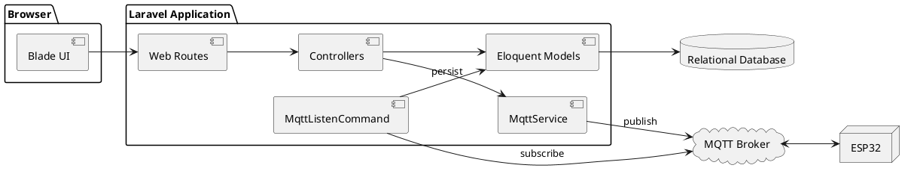

#### Gambar 2.3 Deployment Diagram

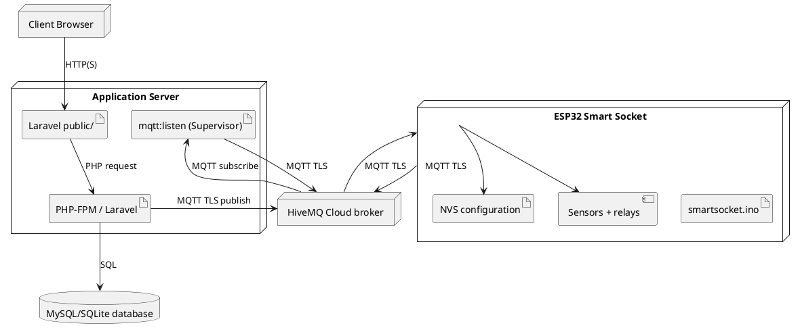

> Tipe database produksi, web server, sistem operasi, dan hostname deployment tidak dinyatakan lengkap pada source. Diagram menggunakan label generik dan memerlukan konfirmasi untuk detail operasional.

### 2.3 Alur deployment

1. Server menempatkan source Laravel pada direktori aplikasi.
2. `public/` menjadi document root web server.
3. PHP-FPM menjalankan aplikasi Laravel.
4. Database menjalankan migration.
5. Supervisor menjaga proses `php artisan mqtt:listen` tetap aktif.
6. Broker MQTT menghubungkan worker dan ESP32.
7. Browser mengakses aplikasi melalui web server.

---

## 3. Perancangan Data

### 3.1 ERD

#### Gambar 3.1 Entity Relationship Diagram

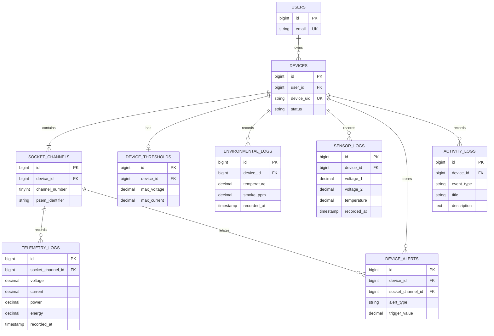

### 3.2 Kamus data utama

#### Tabel 3.1 `devices`

| Kolom | Tipe/ukuran | Constraint | Keterangan |
|---|---|---|---|
| `id` | bigint | PK | Identitas internal. |
| `user_id` | bigint | nullable, FK `users`, null on delete | Pemilik perangkat. |
| `device_uid` | string | unique | UID yang dipakai dalam topic MQTT. |
| `name` | string | default `Smart Socket Main` | Nama tampilan. |
| `status` | string | default `offline` | Status perangkat. |
| `ip_address` | string | nullable | Alamat IP terakhir. |
| `mac_address` | string | nullable | MAC address. |
| `wifi_rssi` | integer | nullable | Kekuatan sinyal WiFi. |
| `firmware_version` | string | default pada migration `2.1.4` | Versi firmware tersimpan. |
| `last_seen_at` | timestamp | nullable | Waktu terakhir terlihat. |
| `mqtt_host`, `mqtt_port`, `mqtt_tls` | string, integer, boolean | nullable | Konfigurasi broker perangkat. |
| `mqtt_username`, `mqtt_password` | text/string terenkripsi di accessor model | nullable, hidden | Kredensial MQTT; tidak ditampilkan pada response normal. |
| `mqtt_client_id` | string | nullable | Client ID MQTT. |
| `created_at`, `updated_at` | timestamp | — | Timestamp Laravel. |

#### Tabel 3.2 `socket_channels`

| Kolom | Tipe/ukuran | Constraint | Keterangan |
|---|---|---|---|
| `id` | bigint | PK | Identitas kanal. |
| `device_id` | bigint | FK cascade | Perangkat induk. |
| `channel_number` | unsigned tinyint | unique bersama `device_id` | Nomor kanal 1 atau 2. |
| `name` | string | — | Nama kanal. |
| `pzem_identifier` | string | — | Identitas PZEM, misalnya `PZEM_01`. |
| `is_active` | boolean | default true | State relay yang tercatat. |
| `status` | string | default `normal` | Status kanal. |
| `created_at`, `updated_at` | timestamp | — | Timestamp Laravel. |

#### Tabel 3.3 `device_thresholds`

| Kolom | Tipe/ukuran | Constraint | Keterangan |
|---|---|---|---|
| `device_id` | bigint | unique, FK cascade | Satu konfigurasi threshold per device. |
| `max_voltage` | decimal(6,2) | default 245.00 | Batas tegangan. |
| `max_current` | decimal(6,2) | default 15.50 | Batas arus. |
| `max_temperature` | decimal(5,2) | default 65.00 | Batas suhu. |
| `max_smoke_ppm` | decimal(7,2) | default 995.00 | Batas asap. |
| `kwh_rate` | decimal(10,2) | default 1444.70 | Tarif energi. |
| `log_interval` | unsigned integer | default 30 | Interval penyimpanan backend. |
| `device_interval` | unsigned integer | default 5 | Interval telemetri firmware. |

#### Tabel 3.4 Log telemetri dan lingkungan

| Tabel | Kolom pengukuran | Relasi | Index |
|---|---|---|---|
| `telemetry_logs` | `voltage`, `current`, `power`, `energy`, `frequency`, `power_factor` | `socket_channel_id` cascade | `recorded_at`; `(socket_channel_id, recorded_at)` |
| `environmental_logs` | `temperature`, `smoke_ppm` | `device_id` cascade | `recorded_at`; `(device_id, recorded_at)` |
| `sensor_logs` | Dua set parameter PZEM (`*_1`, `*_2`) serta `temperature`, `smoke_ppm` | `device_id` cascade | `recorded_at`; `(device_id, recorded_at)` |

Semua log memiliki `recorded_at` dan timestamp Laravel. Precision decimal mengikuti migration: tegangan `6,2`, arus `6,3`, daya `8,2`, energi `10,3`, frekuensi `5,2`, power factor `4,2`, suhu `5,2`, dan smoke `7,2` bila berlaku.

#### Tabel 3.5 `device_alerts` dan `activity_logs`

| Tabel | Kolom penting | Keterangan |
|---|---|---|
| `device_alerts` | `device_id`, nullable `socket_channel_id`, `alert_type`, `trigger_value`, `threshold_value`, `action_taken`, serta status resolved dari migration tambahan | Menyimpan alarm keselamatan dan tindakan yang diambil. |
| `activity_logs` | `device_id`, `event_type`, `title`, nullable `description` | Menyimpan aktivitas device seperti switch, threshold, alert, dan reconnect. |

Tabel bawaan Laravel yang juga dibuat migration: `users`, `password_reset_tokens`, `sessions`, `cache`, `cache_locks`, `jobs`, `job_batches`, dan `failed_jobs`. Detailnya mengikuti migration Laravel bawaan dan tidak menjadi domain Smart Socket.

### 3.3 Relasi Eloquent

| Model | Relasi |
|---|---|
| `User` | `hasMany(Device)` |
| `Device` | `belongsTo(User)`, `hasMany(SocketChannel)`, `hasOne(DeviceThreshold)`, `hasMany(EnvironmentalLog)`, `hasMany(SensorLog)`, `hasOne(SensorLog)` melalui `latestOfMany`, `hasMany(DeviceAlert)`, `hasMany(ActivityLog)` |
| `SocketChannel` | `belongsTo(Device)`, `hasMany(TelemetryLog)`, `hasOne(TelemetryLog)` untuk latest |
| `TelemetryLog` | `belongsTo(SocketChannel)` |
| `EnvironmentalLog`, `SensorLog`, `DeviceAlert`, `ActivityLog` | `belongsTo(Device)`; `DeviceAlert` juga `belongsTo(SocketChannel)` |

#### Gambar 3.2 Class diagram domain dan layanan

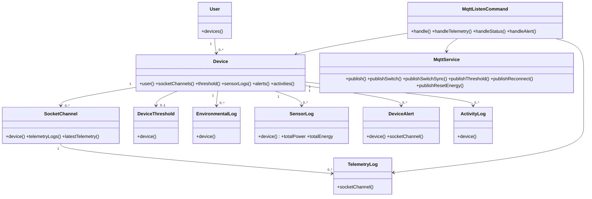

### 3.4 Index dan integritas

- `devices.device_uid` unique untuk mencegah dua device memakai UID yang sama.
- `socket_channels(device_id, channel_number)` unique untuk mencegah kanal ganda pada device.
- Foreign key child domain memakai cascade delete, kecuali `devices.user_id` dan `device_alerts.socket_channel_id` yang menggunakan null on delete.
- Index waktu mendukung query history dan analytics berdasarkan rentang waktu.
- Parsing telemetry dan pembaruan state dilakukan dalam `DB::transaction` pada worker.

---

## 4. Perancangan Perilaku

### 4.1 Activity diagram penerimaan telemetri

#### Gambar 4.1 Activity penerimaan telemetri

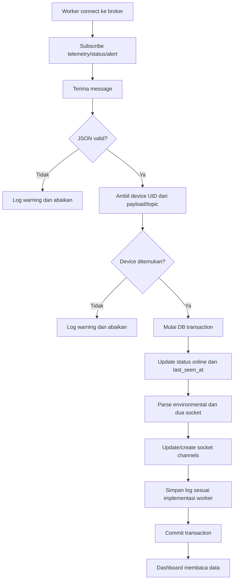

### 4.2 Sequence penerimaan telemetri

#### Gambar 4.2 Sequence telemetri

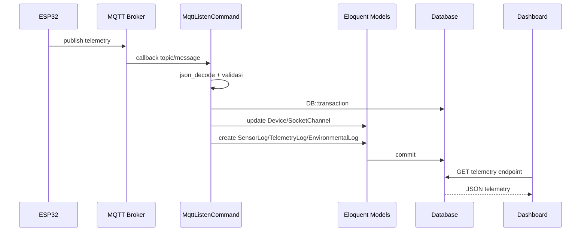

### 4.3 Activity kontrol relay

#### Gambar 4.3 Activity kontrol relay

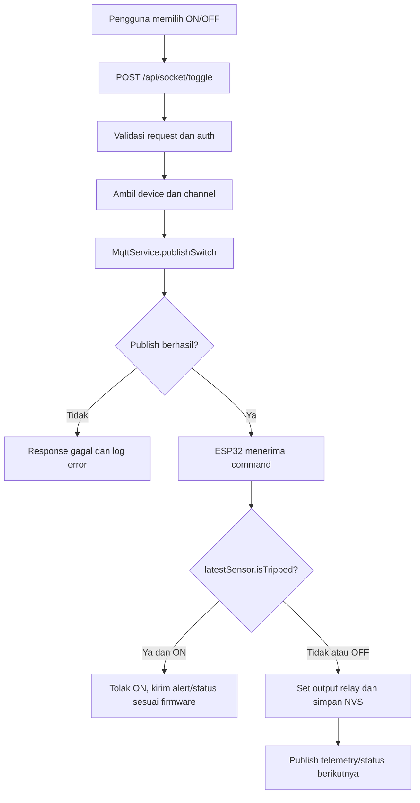

### 4.4 Sequence pengaturan threshold

#### Gambar 4.4 Sequence threshold

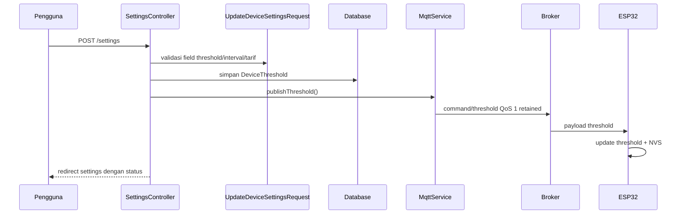

### 4.5 Activity konfigurasi portal firmware

#### Gambar 4.5 Activity portal lokal

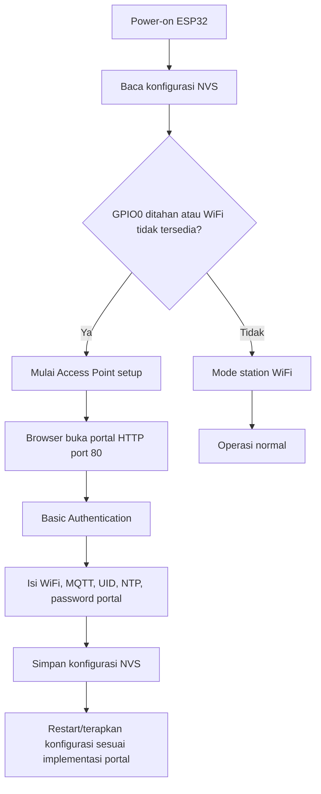

### 4.6 State diagram device dan relay

#### Gambar 4.6 State perangkat

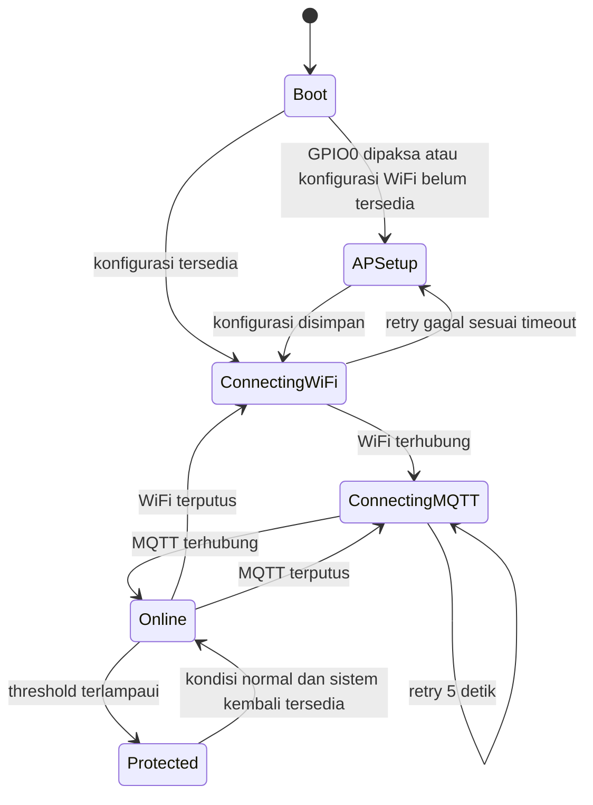

#### Gambar 4.7 State relay

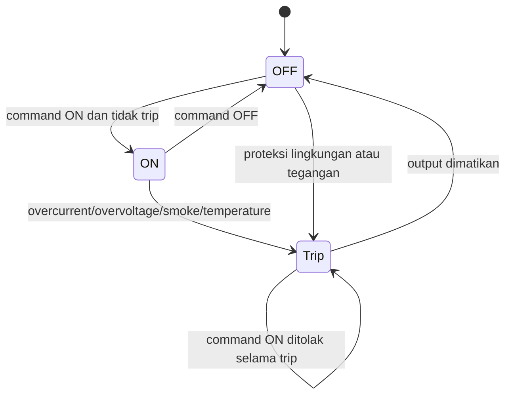

---

## 5. Perancangan Struktural

### 5.1 Tanggung jawab kelas utama

| Kelas | Tanggung jawab |
|---|---|
| `DashboardController` | Dashboard, toggle relay, reconnect, telemetry, notifications, resolve alert. |
| `AnalyticsController` | Menyiapkan halaman analitik berdasarkan data historis. |
| `HistoryController` | Query riwayat, export stream, dan reset riwayat. |
| `SettingsController` | Membaca/mengubah threshold, konfigurasi MQTT, dan reset energi. |
| `MqttService` | Membuat client, connection settings, publish JSON, memilih QoS/retain. |
| `MqttListenCommand` | Menjalankan subscriber daemon, callback topic, retry 5 detik, dan persistence. |
| `Device` | Entitas device, konfigurasi MQTT terenkripsi, dan relasi domain. |
| `SocketChannel` | State relay dan identitas PZEM per kanal. |
| `TelemetryLog`/`SensorLog`/`EnvironmentalLog` | Persistence pembacaan sensor pada granularitas kanal, gabungan, atau lingkungan. |
| `DeviceAlert`/`ActivityLog` | Persistence alarm dan aktivitas. |

### 5.2 Kontrak internal MqttService

| Method | Input utama | Topic | QoS | Retain |
|---|---|---|---:|---:|
| `publishSwitch` | device, socket number, ON/OFF | `command/switch` | 1 | false |
| `publishSwitchSync` | device | `command/switch/sync` | 1 | false |
| `publishThreshold` | threshold values | `command/threshold` | 1 | true |
| `publishReconnect` | device | `command/reconnect` | 1 | false |
| `publishResetEnergy` | device, socket number | `command/reset_energy` | 1 | false |

Semua topic diberi prefix `smartsocket/{device_uid}/`.

---

## 6. Perancangan Antarmuka

### 6.1 Sitemap

#### Gambar 6.1 Struktur navigasi

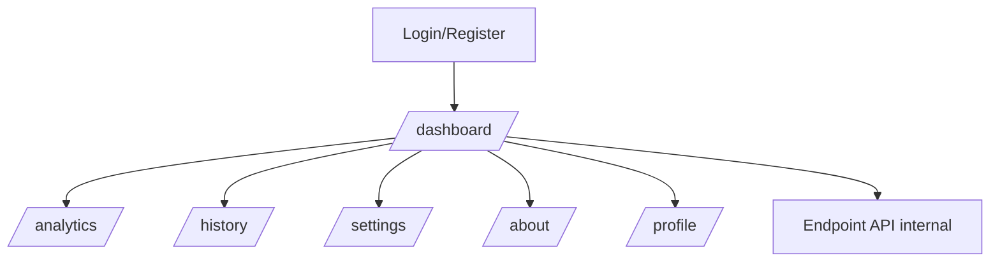

Seluruh route operasional pada `routes/web.php` berada di dalam middleware `auth`; route auth Breeze didefinisikan pada `routes/auth.php`.

### 6.2 Daftar route web

| Method | URI | Controller/method | Nama route | Fungsi |
|---|---|---|---|---|
| GET | `/dashboard` | `DashboardController@index` | `dashboard` | Dashboard. |
| POST | `/api/socket/toggle` | `DashboardController@toggle` | `socket.toggle` | Perintah relay. |
| POST | `/api/device/reconnect` | `DashboardController@reconnect` | `device.reconnect` | Perintah reconnect WiFi. |
| GET | `/api/device/telemetry` | `DashboardController@telemetry` | `device.telemetry` | Telemetri terbaru. |
| GET | `/api/notifications` | `DashboardController@notifications` | `api.notifications` | Daftar alarm. |
| POST | `/api/notifications/resolve-all` | `DashboardController@resolveAllAlerts` | `api.notifications.resolve-all` | Menyelesaikan alarm. |
| GET | `/analytics` | `AnalyticsController@index` | `analytics` | Analitik. |
| GET | `/history` | `HistoryController@index` | `history` | Riwayat. |
| GET | `/history/export` | `HistoryController@export` | `history.export` | Export CSV/stream. |
| POST | `/history/reset` | `HistoryController@reset` | `history.reset` | Reset riwayat. |
| GET | `/settings` | `SettingsController@index` | `settings` | Halaman pengaturan. |
| POST | `/settings` | `SettingsController@update` | `settings.update` | Simpan threshold/interval. |
| PUT | `/settings/mqtt` | `SettingsController@updateMqtt` | `settings.mqtt.update` | Simpan MQTT. |
| POST | `/settings/energy/reset` | `SettingsController@resetEnergy` | `settings.energy.reset` | Reset energi melalui MQTT. |
| GET | `/about` | `AboutController@index` | `about` | Informasi sistem. |
| GET/PATCH/DELETE | `/profile` | `ProfileController` | profile routes | Kelola profil. |

### 6.3 Kontrak payload MQTT

#### Tabel 6.1 Topic MQTT

| Arah | Topic | Payload minimal/utama |
|---|---|---|
| Device → broker | `smartsocket/{UID}/telemetry` | `device_id`, `timestamp`, `sockets.socket_1`, `sockets.socket_2`, `environmental`. |
| Device → broker | `smartsocket/{UID}/status` | Status online/offline dan informasi device sesuai firmware. |
| Device → broker | `smartsocket/{UID}/alert` | Tipe alarm, nilai pemicu, threshold, dan tindakan sesuai firmware. |
| Laravel → device | `.../command/switch` | `socket_number`, `state`, `requested_by`, `timestamp`. |
| Laravel → device | `.../command/switch/sync` | `socket_1`, `socket_2`, `timestamp`. |
| Laravel → device | `.../command/threshold` | `max_voltage`, `max_current`, `max_temperature`, `max_smoke_ppm`, `device_interval`, `log_interval`, `timestamp`. |
| Laravel → device | `.../command/reconnect` | `action: RECONNECT_WIFI`, `timestamp`. |
| Laravel → device | `.../command/reset_energy` | `action: RESET_ENERGY`, `socket_number`, `timestamp`. |

Format payload telemetry yang diterima worker mendukung struktur nested (`sockets`, `environmental`) dan fallback field datar. Detail field aktual mengikuti kode firmware dan parser pada `MqttListenCommand`.

### 6.4 Rancangan wireframe tekstual

| Halaman | Elemen | Aksi/validasi |
|---|---|---|
| Dashboard | Status device, dua kartu socket, telemetri, alarm, kontrol ON/OFF | Request toggle harus authenticated; ON dapat ditolak firmware ketika trip. |
| Analytics | Filter periode dan grafik/rekap energi atau daya | Data dibaca dari log yang tersedia. |
| History | Filter tanggal/perangkat, tabel, export, reset | Reset adalah aksi destruktif dan perlu konfirmasi UI. |
| Settings | Threshold, interval device/log, tarif kWh, konfigurasi MQTT, reset energi | Form Request Laravel memvalidasi input. Rahasia MQTT tidak ditampilkan sembarangan. |
| About | Informasi sistem dan hardware | Read-only. |
| Profile | Nama, email, password sesuai Breeze | Validasi menggunakan `ProfileUpdateRequest` dan auth. |
| Portal ESP32 | WiFi, MQTT, UID, NTP, password portal | Basic Authentication; data disimpan NVS. |

**⚠️ PERLU KONFIRMASI:** wireframe visual final, breakpoint responsif, label UI, serta screenshot belum ditetapkan pada source dokumentasi.

---

## 7. Perancangan Keamanan

### 7.1 Kontrol yang terlihat pada source

1. Route operasional dilindungi middleware `auth`.
2. Laravel Breeze menyediakan autentikasi session dan route auth.
3. Form settings menggunakan Form Request untuk validasi.
4. Credential MQTT pada model `Device` disembunyikan (`hidden`) dan accessor/mutator mengenkripsi/dekripsi nilai.
5. JSON telemetry diproses dalam `try/catch` dan payload invalid dicatat sebagai warning tanpa menghentikan worker.
6. Query menggunakan Eloquent/query builder, bukan konkatenasi SQL manual pada source yang ditinjau.
7. CSRF Laravel berlaku untuk form/session web sesuai middleware framework.

### 7.2 Risiko dan batasan

- `WiFiClientSecure` firmware memakai `setInsecure()`.
- `MqttService` mengatur `setTlsVerifyPeer(false)` dan `setTlsVerifyPeerName(false)`.
- Konfigurasi ini mengaktifkan koneksi TLS tetapi menonaktifkan verifikasi sertifikat/hostname, sehingga rentan man-in-the-middle bila dipakai pada jaringan tidak tepercaya.
- Otorisasi berbasis role/policy tidak terbukti; semua pengguna authenticated berpotensi mengakses route operasional.
- Basic Authentication portal memakai user `admin`; password aktual tidak dicantumkan pada dokumen.

**⚠️ PERLU KONFIRMASI sebelum produksi:** CA certificate/hostname verification, rotasi credential, role/policy authorization, rate limiting, audit retention, backup encryption, dan security headers.

### 7.3 Aturan keamanan rancangan

| Area | Rancangan |
|---|---|
| Secret | Gunakan `.env`/NVS terproteksi; jangan commit credential. |
| MQTT | Gunakan TLS dengan verifikasi peer dan hostname pada produksi. |
| Input web | Pertahankan Form Request, tipe numerik, range threshold, dan CSRF. |
| Input MQTT | Validasi bentuk payload, UID, tipe numerik, dan batas nilai sebelum persistence. |
| Output UI | Gunakan escaping Blade untuk data telemetry/aktivitas. |
| Authorization | Tambahkan policy/role hanya setelah kebutuhan aktor dikonfirmasi. |
| Logging | Jangan log password, token, atau payload yang mengandung secret. |

---

## 8. Perancangan Firmware IoT

### 8.1 Komponen dan pinout

#### Tabel 8.1 Pin mapping firmware

| Komponen | GPIO/interface | Fungsi |
|---|---|---|
| Relay 1 | GPIO18 | Relay socket 1. |
| Relay 2 | GPIO19 | Relay socket 2. |
| DS18B20 | GPIO5, OneWire | Suhu enclosure. |
| MQ-2 | GPIO34, ADC1 CH6 | Asap/gas. |
| PZEM 1 | RX16/TX17, HardwareSerial 1 | Pengukuran socket 1. |
| PZEM 2 | RX26/TX27, HardwareSerial 2 | Pengukuran socket 2. |
| LCD 16x2 | SDA21/SCL22, default address 0x27 | Tampilan lokal. |
| GPIO0 | BOOT | Tahan sekitar 3 detik untuk AP setup. |

Board adalah ESP32 dengan Arduino Core 2.x/3.x menurut komentar firmware. **⚠️ PERLU KONFIRMASI:** model board fisik, wiring power/ground, dan versi library yang dipakai saat build.

### 8.2 Modul firmware

| Modul/fungsi | Tanggung jawab |
|---|---|
| `setup()` | Load NVS, setup pin/sensor/LCD/WiFi/MQTT, dan mode portal. |
| `loop()` | Melayani portal, reconnect, MQTT loop, pembacaan sensor, publish, LCD. |
| `checkWifiAndMqtt()` | Memeriksa dan menjadwalkan retry WiFi/MQTT. |
| `connectMqtt()` | Menghubungkan MQTT dan subscribe command topic. |
| `mqttCallback()` | Menerima command switch, sync, threshold, reconnect, reset energy. |
| `readAllSensors()` | Membaca PZEM, DS18B20, dan MQ-2 ke `SensorSnapshot`. |
| `evaluateThresholds()` | Menerapkan proteksi overvoltage, overcurrent, smoke, temperature. |
| `publishTelemetry()` | Mengirim snapshot sensor. |
| `publishStatus()` | Mengirim heartbeat/status. |
| `sendAlert()` | Mengirim alarm dengan cooldown. |
| `setRelayOutput()` | Mengatur GPIO relay dan menyimpan state ke NVS. |

### 8.3 Scheduler firmware

| Aktivitas | Interval/default |
|---|---:|
| Pembacaan/evaluasi sensor | 1 detik |
| Telemetry | 5 detik, dinamis 1–3600 detik dari command threshold |
| Heartbeat status | 30 detik |
| Rotasi LCD | 2,5 detik |
| Cooldown alert sejenis | 30 detik |
| Retry WiFi | 10 detik |
| Retry MQTT | 5 detik |

### 8.4 Proteksi keselamatan

| Kondisi | Tindakan firmware |
|---|---|
| Overvoltage | Mematikan kedua soket. |
| Overcurrent | Mematikan soket yang overload. |
| Smoke melebihi threshold | Mematikan kedua soket. |
| Overtemperature | Mengirim alert; mematikan kedua soket jika melewati threshold sesuai implementasi. |
| Command ON ketika `isTripped` aktif | Ditolak. |

State relay disimpan pada namespace NVS `relays`, sehingga state terakhir dapat dipulihkan sesuai implementasi `setup()`.

### 8.5 NVS dan portal

Konfigurasi portal menggunakan `Preferences` dan mencakup WiFi, MQTT, Device UID, NTP, password portal, status relay, dan threshold. Portal memakai `WebServer` port 80 dan Basic Authentication. **⚠️ PERLU KONFIRMASI:** kebijakan reset konfigurasi, timeout session portal, dan prosedur pemulihan password.

### 8.6 Sequence device-server

#### Gambar 8.1 Sequence komunikasi device dan server

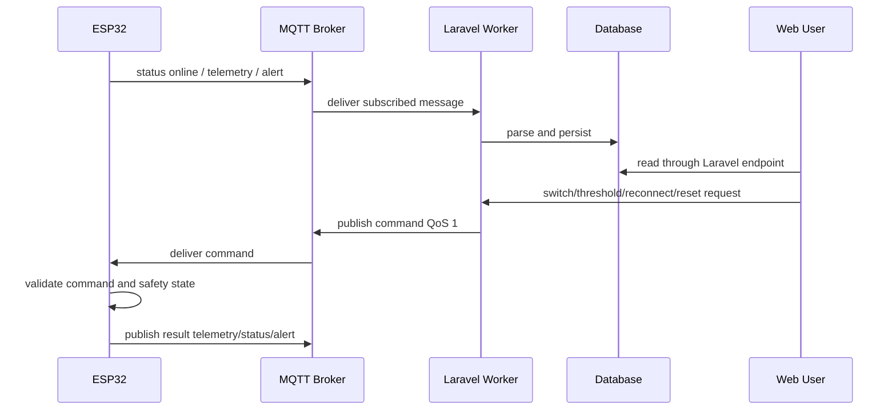

### 8.7 Error handling

- JSON invalid: `Log::warning`, callback selesai, worker tetap hidup.
- Broker tidak tersedia: worker menunggu 5 detik dan mencoba kembali.
- WiFi terputus: firmware retry tiap 10 detik; AP setup dapat diaktifkan sesuai kondisi boot/timeout.
- MQTT publish backend gagal: service menangkap exception, log error, dan mengembalikan `false`.
- Device tidak terdaftar: worker menulis warning dan tidak menyimpan telemetry ke device yang tidak dikenal.
- Timestamp tidak valid/terlalu kecil: worker menggunakan `now()`.

Tidak ditemukan implementasi OTA atau watchdog khusus pada source yang ditinjau. **⚠️ PERLU KONFIRMASI:** apakah mekanisme tersebut dibutuhkan untuk deployment produksi.

---

## 9. Matriks Keterlacakan

#### Tabel 9.1 Kebutuhan ke rancangan

| Requirement SKPL | Use case | Komponen desain | Test case |
|---|---|---|---|
| FR-001–FR-003 | UC-001, UC-002 | Routes, Breeze, controllers, Device model | TC-001–TC-003 |
| FR-004–FR-006 | UC-003, UC-004 | DashboardController, MqttService, MQTT switch topics | TC-004–TC-006 |
| FR-007–FR-008 | UC-005 | MqttService, reconnect topic, worker status | TC-007 |
| FR-009–FR-010 | UC-006 | Notification endpoints, DeviceAlert | TC-008–TC-009 |
| FR-011–FR-013 | UC-007, UC-008 | HistoryController, TelemetryLog/SensorLog, export stream | TC-010–TC-012 |
| FR-014–FR-016 | UC-009 | SettingsController, Form Requests, DeviceThreshold | TC-013–TC-015 |
| FR-017–FR-018 | UC-010 | MqttService reset topic, firmware callback | TC-016–TC-017 |
| FR-019–FR-022 | UC-011, UC-012 | `smartsocket.ino`, `config_portal.h`, NVS | TC-018–TC-020 |
| NFR-001–NFR-005 | Semua UC | Laravel, worker loop, database indexes | TC-021–TC-025 |
| NFR-006–NFR-011 | UC-001, UC-009, UC-012 | Auth, encryption accessor, TLS config, portal auth | TC-026–TC-030 |
| NFR-012–NFR-020 | Sistem | Migration, logging, firmware scheduler, deployment | TC-031–TC-039 |

Nomor test case mengacu pada rencana pengujian formal yang akan dibuat pada Dokumen 3. Hasil aktual belum diisi karena pengujian belum dijalankan pada penyusunan DPPL.

---

## 10. Checklist Kelengkapan

### 10.1 Lengkap berdasarkan source

- [x] Arsitektur device–broker–Laravel–database.
- [x] Component dan deployment diagram PlantUML.
- [x] ERD dan kamus data utama.
- [x] Relasi model Eloquent.
- [x] Activity, sequence, dan state diagram fitur utama.
- [x] Route web dan kontrak topic MQTT.
- [x] Pinout dan scheduler firmware.
- [x] Proteksi, NVS, reconnect, dan error handling.
- [x] Matriks keterlacakan awal.

### 10.2 Membutuhkan konfirmasi atau artefak tambahan

- [ ] Nama instansi, penyusun, dan metodologi.
- [ ] Tipe board ESP32, versi library, dan wiring final.
- [ ] Tipe database/server produksi dan detail deployment.
- [ ] Definisi role/policy pengguna.
- [ ] Verifikasi TLS produksi dan rotasi secret.
- [ ] OTA, watchdog, backup, retensi, kalibrasi, SLA, dan konsumsi daya.
- [ ] Wireframe visual, screenshot, dan hasil pengujian nyata.

**LANJUT: Dokumen 3 — Rencana & Hasil Pengujian.**
