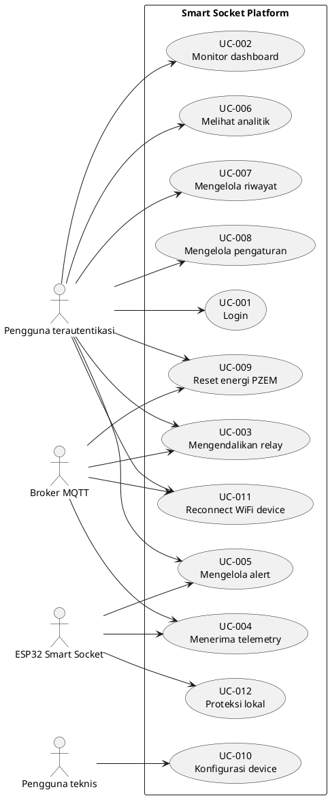

# SKPL — Spesifikasi Kebutuhan Perangkat Lunak

**Nama sistem:** Smart Socket IoT Management Platform  
**Instansi/klien:** ⚠️ PERLU KONFIRMASI: nama instansi atau perusahaan.  
**Versi dokumen:** 1.0  
**Tanggal:** 18 Oktober 2026  
**Penyusun:** ⚠️ PERLU KONFIRMASI: nama penyusun.  
**Metodologi pengembangan:** ⚠️ PERLU KONFIRMASI: Waterfall, Agile, Prototype, atau metodologi lain.  
**Bahasa:** Bahasa Indonesia baku dengan istilah teknis dalam bahasa Inggris.

> Dokumen ini hanya mendokumentasikan fakta yang terlihat pada source code dan dokumentasi repository. Informasi yang tidak tersedia ditandai sebagai **⚠️ PERLU KONFIRMASI**.

## Daftar Isi

1. [Pendahuluan](#1-pendahuluan)
2. [Deskripsi Umum](#2-deskripsi-umum)
3. [Kebutuhan Fungsional](#3-kebutuhan-fungsional)
4. [Kebutuhan Non-Fungsional](#4-kebutuhan-non-fungsional)
5. [Use Case](#5-use-case)
6. [Matriks Keterlacakan Awal](#6-matriks-keterlacakan-awal)
7. [Lampiran A — Daftar Perlu Konfirmasi](#7-lampiran-a--daftar-perlu-konfirmasi)
8. [Checklist Kelengkapan](#8-checklist-kelengkapan)

---

## 1. Pendahuluan

### 1.1 Tujuan dokumen

SKPL ini menetapkan kebutuhan perangkat lunak Smart Socket secara terstruktur. Dokumen menjadi acuan untuk perancangan, implementasi, pengujian, deployment, dan penyusunan manual pengguna.

### 1.2 Lingkup sistem

Sistem mencakup:

1. Firmware ESP32 untuk membaca dua kanal PZEM-004T, sensor suhu DS18B20, sensor asap/gas MQ-2, serta mengendalikan dua relay.
2. Komunikasi perangkat dengan broker MQTT melalui koneksi TLS.
3. Aplikasi Laravel 13 untuk autentikasi, dashboard, analitik, riwayat, pengaturan, kontrol relay, dan notifikasi.
4. MQTT worker Laravel untuk menerima telemetri, status, dan alarm kemudian menyimpannya ke database.
5. Database relasional berbasis migration Laravel.
6. Portal konfigurasi lokal pada ESP32 untuk WiFi, MQTT, Device UID, NTP, dan parameter terkait.

Di luar lingkup yang terbukti dari source code: aplikasi mobile native, role/permission selain middleware `auth`, OTA firmware, dan implementasi watchdog khusus. Status fitur tersebut ditulis pada daftar konfirmasi.

### 1.3 Definisi, akronim, dan singkatan

| Istilah | Definisi |
|---|---|
| ESP32 | Mikrokontroler yang menjalankan firmware Smart Socket. |
| PZEM-004T | Modul pengukur parameter listrik untuk masing-masing soket. |
| MQTT | Protokol publish/subscribe yang dipakai untuk komunikasi perangkat dan backend. |
| Broker | Server perantara MQTT; source code mengacu pada HiveMQ Cloud. |
| Telemetri | Data pengukuran listrik, suhu, asap, dan status relay. |
| LWT | Last Will and Testament MQTT untuk status offline. |
| NVS | Non-Volatile Storage ESP32 melalui `Preferences`. |
| Device UID | Identitas unik perangkat yang menjadi bagian dari topic MQTT. |
| PZEM | Modul pengukur tegangan, arus, daya, energi, frekuensi, dan power factor. |
| Threshold | Nilai ambang proteksi keselamatan. |
| QoS | Quality of Service MQTT. |

### 1.4 Referensi repository

- [README proyek](../README.md)
- [Panduan lengkap](./panduan-lengkap.md)
- [Implementasi Laravel](./implementasi-laravel.md)
- [Implementasi firmware](./implementasi-firmware.md)
- [Routes web](../routes/web.php)
- [Migration database](../database/migrations/)
- [Firmware ESP32](../firmware/smartsocket/smartsocket.ino)
- [Portal konfigurasi firmware](../firmware/smartsocket/config_portal.h)

### 1.5 Gambaran umum dokumen

Bab 2 menjelaskan konteks produk dan batasannya. Bab 3 memuat kebutuhan fungsional dan interface. Bab 4 menetapkan kebutuhan non-fungsional yang dapat diverifikasi dari implementasi atau perlu dikonfirmasi. Bab 5 mendeskripsikan use case. Bab 6 memetakan kebutuhan ke use case dan test case. Lampiran memuat pertanyaan terbuka.

---

## 2. Deskripsi Umum

### 2.1 Perspektif produk

Smart Socket adalah sistem terdistribusi dengan empat bagian utama:

- **Device layer:** ESP32, PZEM-004T, DS18B20, MQ-2, relay, LCD I2C, dan portal konfigurasi.
- **Messaging layer:** broker MQTT sebagai perantara pesan dua arah.
- **Application layer:** Laravel 13, controller, service MQTT, MQTT listener, Blade view, dan autentikasi session.
- **Data layer:** database yang menyimpan perangkat, kanal soket, threshold, telemetri, log lingkungan, sensor log, alert, aktivitas, users, cache, dan jobs sesuai migration.

Aplikasi web tidak berkomunikasi langsung ke ESP32. Perintah dari dashboard dipublish oleh `MqttService` ke broker dan diterima oleh firmware melalui topic command.

#### Gambar 2.1 Diagram konteks sistem

```plantuml
@startuml
left to right direction
actor "Pengguna terautentikasi" as User
actor "ESP32 Smart Socket" as Device
rectangle "Broker MQTT" as Broker
rectangle "Aplikasi Laravel 13" as Laravel
database "Database" as DB

User --> Laravel : Login, dashboard,
kontrol, pengaturan
Laravel <--> Broker : Publish / subscribe MQTT
Device <--> Broker : Telemetry, status,
alert, command
Laravel <--> DB : Baca / simpan data

@enduml
```

**Penjelasan:** Pengguna memakai aplikasi Laravel. ESP32 bertukar pesan dengan broker MQTT. Laravel menerima pesan MQTT melalui worker dan menyimpan data ke database.

### 2.2 Fungsi produk secara umum

1. Mengautentikasi pengguna melalui rute Laravel Breeze.
2. Menampilkan status device dan dua kanal soket pada dashboard.
3. Membaca telemetri terbaru dari database.
4. Mengendalikan relay soket 1 atau 2 melalui MQTT.
5. Mengirim perintah reconnect WiFi ke ESP32.
6. Menampilkan dan menyelesaikan alarm perangkat.
7. Menampilkan analitik daya/energi berdasarkan periode.
8. Menampilkan, memfilter, mengekspor, dan mereset riwayat sensor.
9. Mengatur threshold keselamatan, interval, dan tarif kWh.
10. Mengatur parameter MQTT perangkat.
11. Mengirim perintah reset energi PZEM.
12. Membaca sensor dan menerapkan proteksi lokal pada firmware.
13. Mengirim telemetri, status, dan alert dari firmware ke broker.

### 2.3 Karakteristik pengguna

Tidak ada model role/permission khusus selain autentikasi yang dibuktikan pada source code. Oleh karena itu, aktor aplikasi disebut **Pengguna terautentikasi**, bukan Admin atau Operator.

**Tabel 2.1 Karakteristik aktor**

| Aktor | Peran | Hak akses yang terbukti | Tingkat keahlian |
|---|---|---|---|
| Pengguna terautentikasi | Mengoperasikan dashboard | Mengakses route yang dilindungi `auth`, telemetri, kontrol soket, analitik, riwayat, settings, about, dan profil | ⚠️ PERLU KONFIRMASI: tingkat keahlian pengguna sasaran |
| ESP32 Smart Socket | Device IoT | Membaca sensor, mengendalikan relay, menerima command, mengirim MQTT message | Operator teknis/perangkat otomatis |
| Administrator server | Mengelola runtime deployment | Tidak dimodelkan sebagai aktor aplikasi; secara operasional mengelola PHP, web server, database, dan worker | ⚠️ PERLU KONFIRMASI: apakah peran ini masuk ruang lingkup produk |

### 2.4 Batasan

1. Aplikasi Laravel memerlukan PHP `^8.3` dan Laravel `^13.17` sesuai [composer.json](../composer.json).
2. MQTT worker harus berjalan agar telemetry/status/alert dapat diproses.
3. Topic memakai pola `smartsocket/{device_uid}/...`; Device UID harus konsisten antara ESP32, database, dan konfigurasi MQTT.
4. Firmware membutuhkan file `config_portal.h` pada folder sketch yang sama.
5. Tipe board ESP32, versi Arduino Core, dan versi pasti library firmware belum dipatok dalam repository.
6. Root web server harus menunjuk ke folder `public/` pada deployment Laravel.
7. Informasi rahasia tidak boleh ditulis dalam dokumen atau source code publik.
8. GPIO dan wiring harus mengikuti implementasi firmware yang ada.

### 2.5 Asumsi

1. Broker MQTT tersedia dan dapat diakses oleh server Laravel serta ESP32.
2. Pengguna telah memiliki akun yang dapat login.
3. Database telah dimigrasikan sebelum aplikasi digunakan.
4. Sensor dan relay terhubung secara elektrik sesuai pin mapping firmware.
5. Data pada database adalah sumber yang dibaca oleh dashboard.
6. Threshold keselamatan ditentukan oleh pemilik sistem/teknisi.

### 2.6 Ketergantungan

- PHP, Composer, Laravel, dan package `php-mqtt/client`.
- Node.js/npm dan Vite untuk asset frontend.
- Broker MQTT HiveMQ Cloud atau broker kompatibel.
- ESP32 Arduino Core dan library firmware.
- Database yang didukung konfigurasi Laravel.
- Web server dan process supervisor untuk deployment produksi.

---

## 3. Kebutuhan Fungsional

Prioritas menggunakan nilai **Tinggi**, **Sedang**, atau **Rendah** berdasarkan peran terhadap fungsi inti sistem. Prioritas ini adalah klasifikasi dokumentasi, bukan nilai yang terdapat eksplisit di source code.

### 3.1 Daftar kebutuhan fungsional

**Tabel 3.1 Kebutuhan fungsional**

| ID | Nama | Deskripsi | Prioritas | Aktor |
|---|---|---|---|---|
| FR-001 | Autentikasi pengguna | Sistem harus menyediakan login dan route operasional yang dilindungi middleware `auth`. | Tinggi | Pengguna terautentikasi |
| FR-002 | Inisialisasi device | Sistem harus menyediakan device dan kanal soket yang digunakan dashboard. | Tinggi | Pengguna terautentikasi, Laravel |
| FR-003 | Penerimaan telemetri | Laravel harus subscribe topic telemetry dan memproses payload JSON dari ESP32. | Tinggi | ESP32, Laravel |
| FR-004 | Penyimpanan telemetri | Laravel harus menyimpan nilai listrik per kanal dan nilai lingkungan pada database melalui MQTT listener. | Tinggi | Laravel |
| FR-005 | Status online/offline | Sistem harus menerima status device/LWT dan memperbarui status/last seen device. | Tinggi | ESP32, Laravel |
| FR-006 | Dashboard monitoring | Sistem harus menampilkan data device, dua soket, telemetri, aktivitas, dan jumlah alert yang belum selesai. | Tinggi | Pengguna terautentikasi |
| FR-007 | Kontrol relay | Pengguna harus dapat mengubah keadaan soket 1 atau 2 melalui endpoint toggle dan command MQTT. | Tinggi | Pengguna terautentikasi, ESP32 |
| FR-008 | Sinkronisasi relay | Backend harus dapat mengirim status dua relay untuk sinkronisasi awal ESP32. | Sedang | Laravel, ESP32 |
| FR-009 | Reconnect WiFi | Pengguna harus dapat mengirim perintah reconnect WiFi ke ESP32. | Sedang | Pengguna terautentikasi, ESP32 |
| FR-010 | Notifikasi alarm | Sistem harus menerima alert MQTT, menyimpan alarm, menampilkan jumlah unread, dan menyediakan resolve-all. | Tinggi | ESP32, Pengguna terautentikasi |
| FR-011 | Analitik | Sistem harus menyediakan halaman analitik dengan periode `day`, `week`, atau `month`. | Sedang | Pengguna terautentikasi |
| FR-012 | Riwayat data | Sistem harus menampilkan riwayat dengan filter tanggal/socket, ekspor CSV, dan reset log. | Sedang | Pengguna terautentikasi |
| FR-013 | Pengaturan threshold | Pengguna harus dapat menyimpan batas tegangan, arus, suhu, asap, interval, dan tarif kWh. | Tinggi | Pengguna terautentikasi, ESP32 |
| FR-014 | Pengaturan MQTT device | Pengguna harus dapat menyimpan host, port, TLS, username, password, dan client ID MQTT device. | Tinggi | Pengguna terautentikasi |
| FR-015 | Reset energi | Pengguna harus dapat mengirim command reset PZEM 1, PZEM 2, atau keduanya. | Sedang | Pengguna terautentikasi, ESP32 |
| FR-016 | Pembacaan sensor firmware | Firmware harus membaca dua PZEM, DS18B20, dan MQ-2 sesuai interval yang diprogram. | Tinggi | ESP32 |
| FR-017 | Proteksi lokal | Firmware harus mematikan relay sesuai kondisi overvoltage, overcurrent, asap, dan suhu yang diprogram. | Tinggi | ESP32 |
| FR-018 | Publikasi telemetry firmware | Firmware harus menerbitkan payload telemetry dengan identitas device, timestamp, lingkungan, dua soket, dan relay state. | Tinggi | ESP32 |
| FR-019 | Status dan LWT firmware | Firmware harus menerbitkan status online serta menyediakan LWT offline pada topic status. | Tinggi | ESP32 |
| FR-020 | Portal konfigurasi | Firmware harus menyediakan portal lokal untuk menyimpan konfigurasi WiFi/MQTT/device pada NVS. | Tinggi | Pengguna teknis, ESP32 |
| FR-021 | Reconnect koneksi | Firmware harus mencoba reconnect WiFi dan MQTT dengan interval yang diprogram. | Tinggi | ESP32 |
| FR-022 | Reset energi firmware | Firmware harus meneruskan command reset energi ke PZEM yang dipilih dan mengirim telemetry setelahnya. | Sedang | ESP32 |

### 3.2 Kebutuhan antarmuka eksternal

#### 3.2.1 Antarmuka pengguna

UI web menggunakan route Blade Laravel. Route utama yang dibuktikan pada `routes/web.php` adalah:

**Tabel 3.2 Antarmuka halaman web**

| Method | URL | Fungsi |
|---|---|---|
| GET | `/dashboard` | Monitoring dan kontrol dashboard |
| GET | `/analytics` | Analitik |
| GET | `/history` | Riwayat |
| GET | `/history/export` | Ekspor CSV |
| GET | `/settings` | Form pengaturan |
| GET | `/about` | Informasi sistem |
| GET | `/profile` | Form profil |
| GET/POST | `/login` dan route auth | Autentikasi |

Semua route operasional tersebut berada dalam group middleware `auth`, kecuali route auth yang didefinisikan pada `routes/auth.php`.

#### 3.2.2 Antarmuka software

- Laravel 13 dan PHP 8.3+.
- Eloquent ORM dan database migrations.
- `MqttService` untuk publish command.
- `MqttListenCommand` untuk subscribe dan pemrosesan message.
- Vite untuk asset frontend.

#### 3.2.3 Antarmuka hardware

**Tabel 3.3 Pin yang didefinisikan firmware**

| Komponen | Pin | Arah/fungsi |
|---|---:|---|
| Relay socket 1 | GPIO 18 | Output relay |
| Relay socket 2 | GPIO 19 | Output relay |
| DS18B20 | GPIO 5 | OneWire data |
| MQ-2 | GPIO 34 | Input analog ADC |
| PZEM 1 | RX 16, TX 17 | HardwareSerial 1 |
| PZEM 2 | RX 26, TX 27 | HardwareSerial 2 |
| LCD I2C | SDA 21, SCL 22 | I2C |
| Tombol BOOT | GPIO 0 | Paksa mode AP setup |

#### 3.2.4 Antarmuka komunikasi MQTT

**Tabel 3.4 Topic MQTT**

| Arah | Topic | QoS/retain yang teridentifikasi |
|---|---|---|
| ESP32 → broker | `smartsocket/{UID}/telemetry` | Publish firmware non-retained |
| ESP32 → broker | `smartsocket/{UID}/status` | LWT QoS 1 retained; status publish retained |
| ESP32 → broker | `smartsocket/{UID}/alert` | Publish alert firmware |
| Laravel → ESP32 | `smartsocket/{UID}/command/switch` | Firmware subscribe QoS 1 |
| Laravel → ESP32 | `smartsocket/{UID}/command/switch/sync` | Sinkronisasi state relay |
| Laravel → ESP32 | `smartsocket/{UID}/command/threshold` | Publish service QoS 1 retained |
| Laravel → ESP32 | `smartsocket/{UID}/command/reconnect` | Firmware subscribe QoS 1 |
| Laravel → ESP32 | `smartsocket/{UID}/command/reset_energy` | Firmware subscribe QoS 1 |

### 3.3 Payload antarmuka

#### 3.3.1 Telemetry

```json
{
  "device_id": "<DEVICE_UID>",
  "timestamp": 1720000000,
  "environmental": {
    "temperature": 30.5,
    "smoke_ppm": 120.0
  },
  "sockets": {
    "socket_1": {
      "relay_state": "ON",
      "voltage": 220.1,
      "current": 1.2,
      "power": 250.0,
      "energy": 0.123,
      "frequency": 50.0,
      "power_factor": 0.95
    },
    "socket_2": {
      "relay_state": "OFF",
      "voltage": 0.0,
      "current": 0.0,
      "power": 0.0,
      "energy": 0.0,
      "frequency": 0.0,
      "power_factor": 0.0
    }
  }
}
```

#### 3.3.2 Command switch

```json
{
  "socket_number": 1,
  "state": "ON",
  "requested_by": "web_user",
  "timestamp": 1720000000
}
```

#### 3.3.3 Command threshold

```json
{
  "max_voltage": 245.0,
  "max_current": 15.5,
  "max_temperature": 65.0,
  "max_smoke_ppm": 995.0,
  "device_interval": 5,
  "log_interval": 30,
  "timestamp": 1720000000
}
```

`device_interval` diproses firmware dengan rentang 1–3600 detik. `log_interval` ada pada payload service, tetapi dukungan pemrosesannya pada firmware perlu dikonfirmasi karena fungsi firmware yang terlihat memproses `device_interval`.

#### 3.3.4 Command reconnect dan reset energi

```json
{
  "action": "RECONNECT_WIFI",
  "timestamp": 1720000000
}
```

```json
{
  "action": "RESET_ENERGY",
  "socket_number": 0,
  "timestamp": 1720000000
}
```

Nilai `socket_number` reset energi: `1` untuk PZEM 1, `2` untuk PZEM 2, dan `0` untuk keduanya.

---

## 4. Kebutuhan Non-Fungsional

Kebutuhan berikut dibuat terukur sejauh dapat diturunkan dari source code. Target yang tidak ditetapkan source diberi tanda konfirmasi.

**Tabel 4.1 Kebutuhan non-fungsional**

| ID | Kategori | Kebutuhan terukur | Prioritas | Verifikasi |
|---|---|---|---|---|
| NFR-001 | Performa firmware | Pembacaan sensor dan evaluasi threshold dijadwalkan setiap 1.000 ms. | Tinggi | Test firmware / observasi serial |
| NFR-002 | Performa telemetry | Interval telemetry default firmware adalah 5.000 ms dan dapat diubah 1–3.600 detik. | Tinggi | Test command threshold |
| NFR-003 | Heartbeat | Status online dipublish setiap 30.000 ms. | Sedang | Observasi broker |
| NFR-004 | Reconnect WiFi | Retry WiFi dilakukan dengan interval 10.000 ms. | Tinggi | Simulasi kehilangan WiFi |
| NFR-005 | Reconnect MQTT | Retry MQTT dilakukan dengan interval 5.000 ms setelah WiFi tersedia. | Tinggi | Simulasi broker putus |
| NFR-006 | Cooldown alert | Alert dengan tipe yang sama dibatasi oleh cooldown 30.000 ms. | Sedang | Simulasi threshold terlampaui |
| NFR-007 | Keandalan worker | MQTT worker menangkap exception dan mencoba kembali setelah 5 detik. | Tinggi | Simulasi koneksi gagal |
| NFR-008 | Integritas data | Pemrosesan telemetry Laravel dilakukan dalam transaksi database. | Tinggi | Test integrasi database |
| NFR-009 | Keamanan autentikasi | Route operasional Laravel hanya dapat diakses melalui middleware `auth`. | Tinggi | Feature test tanpa sesi |
| NFR-010 | Validasi input | Endpoint toggle membatasi `socket_number` ke 1/2 dan reset energi ke 0/1/2. | Tinggi | Feature test validasi |
| NFR-011 | Keamanan rahasia | Kredensial MQTT/WiFi/password tidak boleh dicantumkan pada dokumentasi publik atau commit. | Tinggi | Review konfigurasi dan secret scan |
| NFR-012 | Keamanan transport | MQTT dikonfigurasi menggunakan port TLS 8883; implementasi saat ini menonaktifkan verifikasi peer pada firmware dan service. | Tinggi | Review konfigurasi; ⚠️ PERLU KONFIRMASI kebijakan TLS produksi |
| NFR-013 | Usability | Portal menyediakan form konfigurasi dan Basic Authentication dengan user `admin`. | Sedang | Uji penggunaan portal |
| NFR-014 | Maintainability | Komunikasi MQTT backend dipusatkan pada `MqttService`, sedangkan penerimaan pesan dipusatkan pada `MqttListenCommand`. | Sedang | Review arsitektur |
| NFR-015 | Portabilitas backend | Aplikasi memakai konfigurasi Laravel dan migration sehingga dapat dijalankan pada environment PHP 8.3+ yang kompatibel. | Sedang | Instalasi lokal/server |
| NFR-016 | Availability aplikasi | ⚠️ PERLU KONFIRMASI: target uptime dashboard dan MQTT worker per periode pengukuran. | Tinggi | Definisikan SLA |
| NFR-017 | Skalabilitas | ⚠️ PERLU KONFIRMASI: jumlah device dan message rate maksimum yang wajib didukung. | Sedang | Load test |
| NFR-018 | Firmware update | ⚠️ PERLU KONFIRMASI: apakah OTA harus didukung. Tidak ditemukan implementasi OTA pada source yang ditinjau. | Rendah | Review kebutuhan |
| NFR-019 | Watchdog | ⚠️ PERLU KONFIRMASI: apakah watchdog hardware/software wajib digunakan. Tidak ditemukan implementasi watchdog khusus pada source yang ditinjau. | Rendah | Review kebutuhan |
| NFR-020 | Konsumsi daya | ⚠️ PERLU KONFIRMASI: target konsumsi daya firmware dan mode sleep. | Rendah | Pengukuran hardware |

---

## 5. Use Case

### 5.1 Daftar use case

**Tabel 5.1 Daftar use case**

| ID | Nama | Aktor utama | Ringkasan |
|---|---|---|---|
| UC-001 | Login | Pengguna | Masuk ke aplikasi Laravel. |
| UC-002 | Monitor dashboard | Pengguna | Melihat kondisi device, soket, sensor, aktivitas, dan alert. |
| UC-003 | Mengendalikan relay | Pengguna | Mengubah state soket 1/2 melalui MQTT. |
| UC-004 | Menerima telemetry | ESP32/Laravel | Mengirim dan menyimpan data telemetry. |
| UC-005 | Mengelola alert | Pengguna/ESP32 | Menerima alert dan menandai semua alert selesai. |
| UC-006 | Melihat analitik | Pengguna | Melihat agregasi daya/energi berdasarkan periode. |
| UC-007 | Mengelola riwayat | Pengguna | Melihat, ekspor, dan reset riwayat sensor. |
| UC-008 | Mengelola pengaturan | Pengguna | Mengatur threshold, interval, tarif, dan MQTT. |
| UC-009 | Reset energi PZEM | Pengguna/ESP32 | Mengirim reset energi pada kanal yang dipilih. |
| UC-010 | Konfigurasi device | Pengguna teknis/ESP32 | Mengatur WiFi/MQTT/device melalui portal lokal. |
| UC-011 | Reconnect WiFi device | Pengguna/ESP32 | Meminta perangkat melakukan koneksi ulang WiFi. |
| UC-012 | Proteksi lokal | ESP32 | Memutus relay saat threshold keselamatan terlampaui. |

### 5.2 Use Case Diagram

#### Gambar 5.1 Use Case Diagram Smart Socket



**Penjelasan:** Use case hanya menggunakan aktor yang dapat dibuktikan. `Pengguna terautentikasi` mewakili user aplikasi; role Admin/Operator belum dibuktikan oleh role model atau policy.

### 5.3 Skenario use case

#### UC-001 — Login

- **Aktor:** Pengguna.
- **Prasyarat:** Akun tersedia pada tabel users.
- **Alur utama:** (1) Pengguna membuka login; (2) memasukkan kredensial; (3) Laravel memvalidasi; (4) sesi dibuat; (5) pengguna diarahkan ke route terproteksi.
- **Alur alternatif:** Kredensial tidak valid → proses login ditolak dan pengguna tetap pada halaman autentikasi.
- **Pascakondisi:** Pengguna memiliki sesi autentikasi.
- **Test case:** TC-001.

#### UC-002 — Monitor dashboard

- **Aktor:** Pengguna terautentikasi.
- **Prasyarat:** Sesi valid dan device pengguna tersedia.
- **Alur utama:** (1) Pengguna membuka `/dashboard`; (2) controller mengambil device, kanal, telemetry, sensor log, aktivitas, alert, dan threshold; (3) view menampilkan data.
- **Alur alternatif:** Data telemetri belum tersedia → nilai fallback/kosong ditampilkan sesuai controller.
- **Pascakondisi:** Snapshot monitoring tampil.
- **Test case:** TC-002.

#### UC-003 — Mengendalikan relay

- **Aktor:** Pengguna terautentikasi, ESP32, broker.
- **Prasyarat:** Pengguna login; device dan kanal 1/2 tersedia.
- **Alur utama:** (1) UI mengirim `POST /api/socket/toggle`; (2) request divalidasi; (3) controller menentukan state; (4) `MqttService` publish ke topic switch QoS 1; (5) controller memperbarui kanal dan activity log; (6) firmware menerima command dan mengubah relay; (7) telemetry dapat dikirim ulang.
- **Alur alternatif:** MQTT gagal → status `mqtt_delivered=false`; atau firmware sedang `isTripped` dan menolak command ON.
- **Pascakondisi:** State database diperbarui dan command dicatat.
- **Test case:** TC-003.

#### UC-004 — Menerima telemetry

- **Aktor:** ESP32, broker, Laravel.
- **Prasyarat:** ESP32 terhubung MQTT; worker aktif; topic sesuai Device UID.
- **Alur utama:** (1) Firmware membaca sensor; (2) membentuk JSON; (3) publish telemetry; (4) worker subscribe menerima message; (5) JSON divalidasi; (6) data disimpan dalam transaksi; (7) status device dan kanal diperbarui.
- **Alur alternatif:** JSON tidak valid → `Log::warning`, message diabaikan, worker tidak crash.
- **Pascakondisi:** Telemetry terbaru tersedia pada database.
- **Test case:** TC-004.

#### UC-005 — Mengelola alert

- **Aktor:** ESP32, pengguna.
- **Prasyarat:** Topic alert tersedia dan worker aktif.
- **Alur utama:** (1) Firmware mendeteksi kondisi threshold; (2) firmware memutus relay sesuai aturan; (3) firmware publish alert; (4) Laravel menyimpan alert; (5) pengguna melihat jumlah unread; (6) pengguna dapat resolve-all.
- **Alur alternatif:** Alert berulang dengan tipe sama → firmware menerapkan cooldown.
- **Pascakondisi:** Alarm tersimpan dan dapat ditandai selesai.
- **Test case:** TC-005.

#### UC-006 — Melihat analitik

- **Aktor:** Pengguna terautentikasi.
- **Prasyarat:** Sesi valid; data log tersedia atau hasil kosong ditangani view/controller.
- **Alur utama:** Pengguna membuka `/analytics` dan memilih periode `day`, `week`, atau `month`; controller mengagregasi data dan view menampilkan hasil.
- **Alur alternatif:** Parameter periode tidak didukung → sistem menggunakan perilaku default sesuai controller.
- **Pascakondisi:** Ringkasan analitik tampil.
- **Test case:** TC-006.

#### UC-007 — Mengelola riwayat

- **Aktor:** Pengguna terautentikasi.
- **Prasyarat:** Sesi valid.
- **Alur utama:** Pengguna membuka history, mengisi tanggal/socket, melihat tabel, lalu dapat mengekspor CSV.
- **Alur alternatif:** Tidak ada data → hasil kosong; reset history menghapus log yang ditentukan oleh controller.
- **Pascakondisi:** Riwayat ditampilkan/diekspor atau data direset sesuai aksi.
- **Test case:** TC-007.

#### UC-008 — Mengelola pengaturan

- **Aktor:** Pengguna terautentikasi, Laravel, ESP32.
- **Prasyarat:** Device tersedia; form request valid.
- **Alur utama:** (1) Pengguna menyimpan threshold/interval/tarif; (2) Laravel menyimpan threshold; (3) service publish command threshold retained QoS 1; (4) firmware memvalidasi nilai dan menyimpan threshold pada NVS.
- **Alur alternatif:** Publish gagal → nilai database tetap tercatat, tetapi sinkronisasi device tidak berhasil.
- **Pascakondisi:** Settings tersimpan; status sinkronisasi dicatat pada activity/status message.
- **Test case:** TC-008.

#### UC-009 — Reset energi PZEM

- **Aktor:** Pengguna terautentikasi, ESP32.
- **Prasyarat:** Device dan MQTT tersedia.
- **Alur utama:** Pengguna memilih socket 0/1/2; Laravel memvalidasi dan publish command reset; firmware memanggil reset PZEM; firmware publish telemetry.
- **Alur alternatif:** MQTT atau reset PZEM gagal → status gagal dicatat/log.
- **Pascakondisi:** Register energi PZEM yang dipilih diminta reset dan dashboard menerima telemetry berikutnya.
- **Test case:** TC-009.

#### UC-010 — Konfigurasi device

- **Aktor:** Pengguna teknis, ESP32.
- **Prasyarat:** ESP32 menyala; portal tersedia atau mode AP dipaksa dengan GPIO0.
- **Alur utama:** (1) Pengguna terhubung ke AP/akses IP portal; (2) login Basic Authentication; (3) mengisi WiFi, MQTT, UID, NTP, dan password portal; (4) konfigurasi disimpan ke NVS; (5) perangkat restart sesuai implementasi portal.
- **Alur alternatif:** WiFi belum dikonfigurasi/gagal → portal AP dibuka; GPIO0 ditahan saat boot → mode AP dipaksa.
- **Pascakondisi:** Config tersedia pada NVS dan device mencoba tersambung.
- **Test case:** TC-010.

#### UC-011 — Reconnect WiFi device

- **Aktor:** Pengguna, Laravel, ESP32.
- **Prasyarat:** Pengguna login dan MQTT device terkonfigurasi.
- **Alur utama:** Pengguna memanggil `/api/device/reconnect`; Laravel publish command; firmware disconnect dan memanggil `WiFi.begin` kembali.
- **Alur alternatif:** Publish gagal → response menyatakan `mqtt_delivered=false`.
- **Pascakondisi:** ESP32 mencoba koneksi ulang.
- **Test case:** TC-011.

#### UC-012 — Proteksi lokal

- **Aktor:** ESP32.
- **Prasyarat:** Sensor terbaca dan threshold lebih besar dari nol.
- **Alur utama:** Firmware mengevaluasi tegangan, arus, asap, dan suhu setiap 1 detik; jika terlampaui, relay yang sesuai dimatikan dan alert dikirim.
- **Alur alternatif:** Kondisi normal kembali → lockout dapat direset sesuai kondisi pada kode; command ON tetap ditolak ketika `isTripped` aktif.
- **Pascakondisi:** Relay berada pada kondisi aman menurut aturan firmware.
- **Test case:** TC-012.

---

## 6. Matriks Keterlacakan Awal

Matriks ini menghubungkan kebutuhan dengan use case, komponen desain yang sudah tersedia, dan ID test case yang akan digunakan pada dokumen pengujian. Rincian implementasi dan hasil aktual didefinisikan pada DPPL serta dokumen pengujian.

**Tabel 6.1 Traceability matrix**

| Kebutuhan | Use case | Komponen desain/source | Test case |
|---|---|---|---|
| FR-001 | UC-001 | `routes/auth.php`, middleware `auth`, views auth | TC-001 |
| FR-002 | UC-002 | `Device`, `SocketChannel`, `CreateUserDevice`, migrations | TC-002 |
| FR-003–FR-005 | UC-004 | `MqttListenCommand`, `MqttService`, topic telemetry/status/alert | TC-004 |
| FR-006 | UC-002 | `DashboardController`, dashboard Blade views | TC-002 |
| FR-007–FR-008 | UC-003 | `DashboardController::toggle`, `MqttService::publishSwitch/Sync`, firmware callback | TC-003 |
| FR-009, FR-021 | UC-011 | `DashboardController::reconnect`, `MqttService::publishReconnect`, `checkWifiAndMqtt` | TC-011 |
| FR-010 | UC-005 | `DeviceAlert`, alert handler, notification routes | TC-005 |
| FR-011 | UC-006 | `AnalyticsController`, analytics view | TC-006 |
| FR-012 | UC-007 | `HistoryController`, log models, export route | TC-007 |
| FR-013–FR-014 | UC-008 | `SettingsController`, Form Request, `MqttService::publishThreshold` | TC-008 |
| FR-015, FR-022 | UC-009 | `SettingsController::resetEnergy`, `publishResetEnergy`, firmware reset handler | TC-009 |
| FR-016, FR-018–FR-019 | UC-004 | `readAllSensors`, `publishTelemetry`, `publishStatus` | TC-004 |
| FR-017 | UC-012 | `evaluateThresholds`, `sendAlert`, relay output | TC-012 |
| FR-020 | UC-010 | `config_portal.h`, `cfgLoad`, `cfgSave`, portal handlers | TC-010 |
| NFR-001–NFR-006 | UC-004/UC-005/UC-012 | Interval constants dan scheduler `millis()` firmware | TC-013 |
| NFR-007–NFR-008 | UC-004 | Exception loop dan `DB::transaction` | TC-014 |
| NFR-009–NFR-011 | UC-001/UC-003/UC-008 | Middleware, validation, `.env`/NVS configuration | TC-015 |
| NFR-012 | UC-004/UC-008 | `WiFiClientSecure`, `ConnectionSettings` | TC-016 |
| NFR-016–NFR-020 | — | ⚠️ PERLU KONFIRMASI target SLA, scale, OTA, watchdog, power | TC-017–TC-020 |

---

## 7. Lampiran A — Daftar Perlu Konfirmasi

1. Nama instansi/klien.
2. Nama penyusun dan reviewer.
3. Metodologi pengembangan yang resmi digunakan.
4. Latar belakang masalah formal dan indikator kondisi sebelum sistem.
5. Tujuan sistem dalam format yang disetujui pemilik proyek.
6. Apakah terdapat role bisnis Admin, Operator, atau Manajer. Source code yang ditinjau hanya membuktikan autentikasi umum.
7. Target uptime, response time dashboard, jumlah device, dan message rate.
8. Kebijakan TLS produksi: CA certificate dan verifikasi peer/name.
9. Apakah OTA firmware, watchdog, sleep mode, dan pengukuran konsumsi daya diwajibkan.
10. Tipe board ESP32, versi Arduino Core, versi library, dan port flash.
11. Model database produksi dan strategi backup/retensi data.
12. Kalibrasi MQ-2, batas threshold yang disetujui, dan prosedur keselamatan kelistrikan.
13. Apakah `log_interval` harus diproses firmware atau hanya digunakan backend.
14. Target browser, dukungan mobile/responsive, dan standar accessibility.
15. Kontak dukungan resmi untuk manual book.

---

## 8. Checklist Kelengkapan

### 8.1 Lengkap berdasarkan source code

- [x] Tujuan teknis dan lingkup sistem berdasarkan struktur proyek.
- [x] Aktor yang terbukti dari route, firmware, dan worker.
- [x] Daftar kebutuhan fungsional dengan ID unik.
- [x] Daftar kebutuhan non-fungsional dengan batas terukur yang tersedia.
- [x] Daftar route dan antarmuka MQTT.
- [x] Pin mapping firmware.
- [x] Use case diagram PlantUML.
- [x] Skenario use case inti.
- [x] Matriks keterlacakan awal.

### 8.2 Membutuhkan data tambahan

- [ ] Identitas instansi, penyusun, reviewer, dan metodologi.
- [ ] Latar belakang masalah dan tujuan bisnis formal.
- [ ] SLA performa, availability, scalability, dan retensi data.
- [ ] Role bisnis dan policy authorization.
- [ ] Detail target deployment dan keamanan TLS produksi.
- [ ] Spesifikasi build final firmware, OTA, watchdog, dan konsumsi daya.
- [ ] Hasil pengujian aktual.
- [ ] Kontak dukungan dan screenshot manual book.

**Status dokumen:** SKPL selesai sebagai baseline berbasis source code; item pada bagian 8.2 harus dikonfirmasi sebelum dokumen dianggap final untuk penyerahan akademik/produksi.

**LANJUT:** Dokumen 2 — DPPL (Deskripsi Perancangan Perangkat Lunak).
