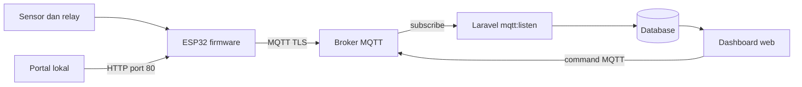

# Dokumen 4 — Manual Book Smart Socket

**Nama sistem:** Smart Socket IoT Management Platform  
**Instansi/klien:** ⚠️ PERLU KONFIRMASI: nama instansi atau perusahaan.  
**Versi:** 1.0  
**Tanggal:** 18 Oktober 2026  
**Penyusun:** ⚠️ PERLU KONFIRMASI: nama penyusun.  

> Manual ini menjelaskan instalasi, konfigurasi, penggunaan, pemeliharaan, dan troubleshooting berdasarkan source code yang tersedia. Jangan memasukkan credential produksi pada contoh, screenshot, log, atau repository.

## Daftar Isi

1. [Pendahuluan](#1-pendahuluan)
2. [Gambaran Sistem](#2-gambaran-sistem)
3. [Kebutuhan](#3-kebutuhan)
4. [Instalasi Lokal di VS Code](#4-instalasi-lokal-di-vs-code)
5. [Instalasi dan Deployment Server](#5-instalasi-dan-deployment-server)
6. [Instalasi Firmware ESP32](#6-instalasi-firmware-esp32)
7. [Konfigurasi Portal ESP32](#7-konfigurasi-portal-esp32)
8. [Panduan Pengguna](#8-panduan-pengguna)
9. [Pemeliharaan](#9-pemeliharaan)
10. [Troubleshooting](#10-troubleshooting)
11. [FAQ](#11-faq)
12. [Checklist Operasional](#12-checklist-operasional)
13. [Lampiran](#13-lampiran)

---

## 1. Pendahuluan

### 1.1 Tujuan

Manual Book ini ditujukan untuk developer, administrator server, teknisi firmware, dan pengguna terautentikasi yang perlu memasang atau mengoperasikan Smart Socket.

### 1.2 Fungsi utama

Smart Socket mengukur parameter listrik pada dua soket, memantau suhu dan asap, mengendalikan relay, mengirim data melalui MQTT, dan menyediakan dashboard Laravel untuk pemantauan serta pengaturan.

### 1.3 Batasan dokumentasi

Role bisnis seperti Admin, Operator, atau Manajer belum dibuktikan secara eksplisit oleh source code. Manual menggunakan istilah **pengguna terautentikasi** dan **pengguna teknis**. **⚠️ PERLU KONFIRMASI:** pembagian hak akses resmi.

---

## 2. Gambaran Sistem

### 2.1 Alur komunikasi



### 2.2 Komponen

| Komponen | Fungsi |
|---|---|
| ESP32 | Menjalankan firmware dan mengatur sensor/relay. |
| Dua PZEM-004T v3.0 | Mengukur tegangan, arus, daya, energi, frekuensi, dan power factor per soket. |
| DS18B20 | Mengukur suhu enclosure. |
| MQ-2 | Mengukur indikator asap/gas. |
| Dua relay | Memutus/menyambung soket 1 dan 2. |
| LCD 16x2 I2C | Menampilkan informasi lokal. |
| MQTT broker | Perantara komunikasi device dan Laravel. |
| Laravel | Dashboard, persistence, command, history, analytics, settings. |
| Database | Menyimpan device, channel, telemetry, environmental log, sensor log, alert, dan activity. |

### 2.3 Topic MQTT

| Arah | Topic |
|---|---|
| Device → server | `smartsocket/{DEVICE_UID}/telemetry` |
| Device → server | `smartsocket/{DEVICE_UID}/status` |
| Device → server | `smartsocket/{DEVICE_UID}/alert` |
| Server → device | `smartsocket/{DEVICE_UID}/command/switch` |
| Server → device | `smartsocket/{DEVICE_UID}/command/switch/sync` |
| Server → device | `smartsocket/{DEVICE_UID}/command/threshold` |
| Server → device | `smartsocket/{DEVICE_UID}/command/reconnect` |
| Server → device | `smartsocket/{DEVICE_UID}/command/reset_energy` |

---

## 3. Kebutuhan

### 3.1 Komputer lokal

- Windows atau OS development lain.
- Visual Studio Code.
- PHP 8.3 atau lebih baru.
- Composer.
- Node.js dan npm.
- Git, bila source diambil dari repository.
- Arduino IDE 2.x atau PlatformIO.
- Driver USB board ESP32.

### 3.2 Server

- Linux server dengan PHP 8.3+, Composer, dan ekstensi Laravel.
- Nginx atau Apache dengan document root ke `public/`.
- Database yang dikonfigurasi Laravel; SQLite cocok untuk instalasi kecil.
- Broker MQTT yang dapat dijangkau server melalui TLS port 8883.
- Supervisor atau systemd untuk proses `mqtt:listen`.
- HTTPS untuk akses dashboard produksi.

### 3.3 Hardware dan wiring

| Komponen | GPIO/interface |
|---|---|
| Relay 1 | GPIO18 |
| Relay 2 | GPIO19 |
| DS18B20 | GPIO5 / OneWire |
| MQ-2 | GPIO34 / ADC1 CH6 |
| PZEM 1 | RX16, TX17 / HardwareSerial 1 |
| PZEM 2 | RX26, TX27 / HardwareSerial 2 |
| LCD | SDA21, SCL22 / address default 0x27 |
| Mode AP paksa | GPIO0 ditahan sekitar 3 detik saat boot |

**Peringatan keselamatan:** wiring listrik AC, relay, dan beban harus dikerjakan teknisi yang kompeten. Pastikan perangkat tidak bertegangan saat wiring. Jangan menguji threshold listrik menggunakan beban yang tidak terkontrol.

---

## 4. Instalasi Lokal di VS Code

### 4.1 Membuka project

Buka folder aplikasi Laravel, yaitu `smartsocket`, bukan folder `vendor` atau `storage`.

```powershell
Set-Location 'C:\path\ke\smartsocket'
code .
```

Jika menggunakan repository:

```powershell
git clone <URL_REPOSITORY> 'C:\path\ke\smartsocket'
Set-Location 'C:\path\ke\smartsocket'
code .
```

### 4.2 Memasang dependency

Jalankan pada terminal VS Code:

```powershell
composer install
Copy-Item .env.example .env
php artisan key:generate
npm install
```

Jangan menimpa `.env` yang sudah berisi konfigurasi lokal. Jangan commit `.env`.

### 4.3 Menyiapkan database SQLite lokal

```powershell
New-Item -ItemType File -Force database\database.sqlite
```

Isi `.env` dengan konfigurasi lokal:

```dotenv
APP_ENV=local
APP_DEBUG=true
APP_URL=http://127.0.0.1:8000
DB_CONNECTION=sqlite
DB_DATABASE=database/database.sqlite
```

Jalankan migration dan seeder:

```powershell
php artisan migrate
php artisan db:seed
```

Seeder dan akun awal mengikuti source code. Gunakan password hanya dari output/prosedur internal yang aman, lalu segera ganti melalui profil. Jangan salin credential awal ke dokumentasi.

### 4.4 Konfigurasi MQTT lokal

Tambahkan placeholder yang benar-benar diberikan operator broker:

```dotenv
MQTT_HOST=<broker-host>
MQTT_PORT=8883
MQTT_TLS=true
MQTT_AUTH_USERNAME=<mqtt-username>
MQTT_AUTH_PASSWORD=<mqtt-password>
MQTT_CLIENT_ID=laravel_backend_daemon
MQTT_TIMEOUT=10
DEFAULT_DEVICE_UID=<DEVICE_UID>
```

Pastikan `DEFAULT_DEVICE_UID`, UID firmware, dan `devices.device_uid` merujuk pada device yang sama.

### 4.5 Menjalankan aplikasi

Gunakan tiga terminal VS Code.

**Terminal 1 — Laravel:**

```powershell
php artisan serve --host=127.0.0.1 --port=8000
```

**Terminal 2 — Vite:**

```powershell
npm run dev
```

**Terminal 3 — MQTT worker:**

```powershell
php artisan mqtt:listen --device=<DEVICE_UID>
```

Buka `http://127.0.0.1:8000`, login, lalu buka dashboard. Worker harus aktif agar telemetry/status/alert diproses.

### 4.6 Pemeriksaan lokal

```powershell
php artisan route:list
php artisan migrate:status
php artisan test
npm run build
```

Jika test atau build gagal, simpan output error dan jangan menyatakan instalasi lulus sebelum penyebabnya diselesaikan.

---

## 5. Instalasi dan Deployment Server

### 5.1 Menyiapkan direktori aplikasi

Contoh berikut memakai `/var/www/smartsocket`. Sesuaikan dengan server.

```bash
sudo mkdir -p /var/www/smartsocket
sudo chown -R "$USER":"$USER" /var/www/smartsocket
cd /var/www/smartsocket
# clone atau salin source ke direktori ini
composer install --no-dev --optimize-autoloader
npm ci
npm run build
cp .env.example .env
php artisan key:generate
```

### 5.2 Environment produksi

```dotenv
APP_NAME="Smart Socket"
APP_ENV=production
APP_DEBUG=false
APP_URL=https://smart-socket.example
APP_KEY=<hasil-key-generate>
DB_CONNECTION=sqlite
DB_DATABASE=/var/www/smartsocket/database/database.sqlite
SESSION_DRIVER=database
CACHE_STORE=database
QUEUE_CONNECTION=database
MQTT_HOST=<broker-host>
MQTT_PORT=8883
MQTT_TLS=true
MQTT_AUTH_USERNAME=<mqtt-username>
MQTT_AUTH_PASSWORD=<mqtt-password>
MQTT_CLIENT_ID=laravel_backend_daemon_server
MQTT_TIMEOUT=10
DEFAULT_DEVICE_UID=<DEVICE_UID>
```

Gunakan database produksi yang telah disetujui. Jenis database produksi final belum ditetapkan pada source. **⚠️ PERLU KONFIRMASI:** SQLite atau MySQL/PostgreSQL untuk deployment resmi.

### 5.3 Migration dan cache

```bash
cd /var/www/smartsocket
mkdir -p database
# jika menggunakan SQLite
sudo -u www-data touch database/database.sqlite
php artisan migrate --force
php artisan db:seed --force
php artisan storage:link
php artisan optimize
```

Sebelum `db:seed` di server yang sudah memiliki data, pastikan seeder aman dijalankan ulang dan backup telah tersedia.

### 5.4 Permission

```bash
sudo chown -R www-data:www-data /var/www/smartsocket/storage /var/www/smartsocket/bootstrap/cache
sudo chmod -R ug+rwX /var/www/smartsocket/storage /var/www/smartsocket/bootstrap/cache
```

Jangan membuat `.env`, private key, atau database dapat diunduh dari document root.

### 5.5 Web server

Document root harus menunjuk ke:

```text
/var/www/smartsocket/public
```

Aktifkan HTTPS dan pastikan PHP-FPM menjalankan PHP 8.3+. Konfigurasi Nginx/Apache final bergantung pada infrastruktur dan belum tercantum lengkap pada source. **⚠️ PERLU KONFIRMASI:** domain, service PHP-FPM, dan konfigurasi TLS.

### 5.6 Menjalankan MQTT worker dengan Supervisor

File contoh tersedia pada [smartsocket-mqtt.conf](../deploy/supervisor/smartsocket-mqtt.conf). Sesuaikan path aplikasi, binary PHP, user, dan log.

```bash
sudo cp deploy/supervisor/smartsocket-mqtt.conf /etc/supervisor/conf.d/smartsocket-mqtt.conf
sudo supervisorctl reread
sudo supervisorctl update
sudo supervisorctl start smartsocket-mqtt
sudo supervisorctl status smartsocket-mqtt
```

Periksa log:

```bash
tail -f storage/logs/mqtt-supervisor.log
```

Worker diharapkan reconnect setelah exception sesuai implementasi command. Pastikan tidak ada credential yang ikut tercetak pada log.

### 5.7 Cache dan verifikasi deployment

```bash
php artisan config:cache
php artisan route:cache
php artisan view:cache
php artisan about
php artisan migrate:status
sudo supervisorctl status smartsocket-mqtt
```

Uji URL dashboard melalui HTTPS, login, endpoint telemetry, publish command, dan penerimaan telemetry dari device uji.

---

## 6. Instalasi Firmware ESP32

### 6.1 Menyiapkan sketch

Buka folder:

```text
firmware/smartsocket/
```

File utama adalah `smartsocket.ino`; file `config_portal.h` harus berada pada folder sketch yang sama.

### 6.2 Library firmware

Firmware mengimpor library berikut:

- `WiFi.h`
- `WiFiClientSecure.h`
- `PubSubClient.h`
- `ArduinoJson.h`
- `PZEM004Tv30.h`
- `OneWire.h`
- `DallasTemperature.h`
- `Wire.h`
- `LiquidCrystal_I2C.h`
- `Preferences.h`

Pasang board ESP32 dan library yang kompatibel melalui Arduino IDE Library Manager atau PlatformIO. Versi library final belum dipatok pada repository. **⚠️ PERLU KONFIRMASI:** versi dependency yang disertifikasi.

### 6.3 Memilih board dan port

1. Hubungkan ESP32 menggunakan kabel USB data.
2. Buka Arduino IDE.
3. Pilih board ESP32 yang sesuai dengan hardware aktual.
4. Pilih COM port yang muncul.
5. Pilih baud rate Serial Monitor sesuai konfigurasi source/build.

Model board dan baud rate final belum disebutkan secara eksplisit. Jangan memilih board secara acak jika layout pin berbeda.

### 6.4 Flash firmware

1. Buka `smartsocket.ino`.
2. Pastikan `config_portal.h` terbaca tanpa error include.
3. Compile/Verify.
4. Tekan Upload.
5. Jika board meminta bootloader, tahan tombol BOOT sesuai prosedur board.
6. Buka Serial Monitor dan catat hasil boot.
7. Matikan lalu nyalakan kembali untuk memeriksa persistensi NVS.

Jangan masukkan credential produksi permanen ke source code. Konfigurasi runtime dilakukan melalui portal dan NVS.

### 6.5 Verifikasi awal firmware

- LCD menyala pada address yang benar (`0x27` atau address hardware yang sesuai).
- Relay tidak aktif tanpa perintah yang diharapkan.
- PZEM 1 dan PZEM 2 terbaca pada kanal yang benar.
- DS18B20 dan MQ-2 menghasilkan nilai.
- ESP32 tersambung ke WiFi.
- ESP32 tersambung ke MQTT.
- Telemetry dan status terlihat pada broker uji.

---

## 7. Konfigurasi Portal ESP32

### 7.1 Masuk ke mode AP setup

Mode AP dapat dipicu dengan menahan GPIO0/BOOT sekitar 3 detik saat power-on sesuai komentar firmware. Kondisi WiFi belum tersedia juga dapat menyebabkan mode setup berdasarkan implementasi portal.

1. Matikan ESP32.
2. Tahan tombol BOOT/GPIO0.
3. Nyalakan perangkat dan tahan sekitar 3 detik.
4. Hubungkan laptop/ponsel ke SSID AP yang dibuat firmware.
5. Buka alamat portal melalui browser.
6. Masukkan Basic Authentication menggunakan credential yang diberikan teknisi.

Password aktual tidak ditulis dalam manual publik. **⚠️ PERLU KONFIRMASI:** SSID AP, alamat IP portal, dan prosedur reset password final.

### 7.2 Field konfigurasi

| Field | Isi |
|---|---|
| WiFi SSID | Nama jaringan WiFi device. |
| WiFi password | Password jaringan; jangan dicatat pada laporan. |
| MQTT host | Host broker. |
| MQTT port | Umumnya `8883` untuk MQTT TLS pada konfigurasi proyek. |
| MQTT username/password | Credential broker. |
| Device UID | UID unik yang sama dengan database/topic. |
| MQTT client ID | ID client unik. |
| NTP | Konfigurasi waktu yang tersedia pada portal. |
| Portal password | Password Basic Authentication portal. |

Simpan konfigurasi dan ikuti perilaku restart yang ditampilkan firmware. Setelah restart, verifikasi device kembali connect ke WiFi dan MQTT.

### 7.3 Threshold dan interval

Threshold yang digunakan firmware:

- `max_voltage`: default source 245 V.
- `max_current`: default source 15,5 A.
- `max_temperature`: default source 65 °C.
- `max_smoke_ppm`: default source 995 ppm.
- `device_interval`: default 5 detik dan dibatasi implementasi pada 1–3600 detik.

Nilai operasional harus ditentukan teknisi berdasarkan rating hardware dan risiko instalasi. Jangan mengubah threshold tanpa prosedur keselamatan.

---

## 8. Panduan Pengguna

### 8.1 Login

**Tujuan:** masuk ke dashboard.

1. Buka URL aplikasi.
2. Pilih **Login**.
3. Masukkan email dan password akun.
4. Tekan **Login**.
5. Pastikan diarahkan ke dashboard.

[Tempat Screenshot: halaman login]

**Hasil yang diharapkan:** pengguna authenticated dapat mengakses halaman operasional; guest diarahkan ke login.

### 8.2 Dashboard dan telemetri

1. Buka **Dashboard**.
2. Periksa status device, IP/MAC, RSSI, firmware, dan waktu terakhir terlihat bila tersedia.
3. Periksa kartu Socket 1 dan Socket 2.
4. Periksa tegangan, arus, daya, energi, frekuensi, dan power factor.
5. Periksa suhu, asap, dan notifikasi.
6. Pastikan nilai diperbarui saat worker menerima telemetry.

[Tempat Screenshot: halaman dashboard]

**Catatan:** dashboard membaca data backend. Jika worker berhenti, data baru tidak akan masuk walaupun device masih membaca sensor.

### 8.3 Mengendalikan relay

1. Pada dashboard, pilih Socket 1 atau Socket 2.
2. Tekan toggle ON/OFF.
3. Tunggu response aplikasi.
4. Periksa perubahan relay dan telemetry berikutnya.
5. Jika kondisi trip aktif, command ON dapat ditolak firmware.

[Tempat Screenshot: kartu kontrol socket]

**Peringatan:** selalu pastikan beban aman sebelum menyalakan relay.

### 8.4 Reconnect WiFi device

1. Buka dashboard.
2. Pilih aksi reconnect device.
3. Konfirmasi jika dialog tersedia.
4. Tunggu firmware memproses `command/reconnect`.
5. Amati status dan `last_seen_at`.

[Tempat Screenshot: tombol reconnect]

### 8.5 Notifikasi dan resolve alarm

1. Buka panel notifikasi.
2. Baca tipe alarm, nilai pemicu, threshold, dan tindakan.
3. Periksa kondisi fisik sebelum menyalakan kembali relay.
4. Gunakan **Resolve all** hanya setelah kondisi ditangani.

[Tempat Screenshot: panel notifikasi]

### 8.6 Analytics

1. Buka **Analytics**.
2. Pilih periode yang tersedia.
3. Periksa grafik/rekap daya dan energi.
4. Bandingkan data dengan history bila diperlukan.

[Tempat Screenshot: halaman analytics]

### 8.7 History dan export

1. Buka **History**.
2. Masukkan filter periode/perangkat bila tersedia.
3. Periksa data log.
4. Tekan **Export** untuk memperoleh CSV.
5. Buka file CSV pada aplikasi spreadsheet.

[Tempat Screenshot: halaman history]

Sebelum reset, lakukan export atau backup. Reset history adalah tindakan destruktif terhadap data log device yang dipilih.

### 8.8 Reset history

1. Pastikan data telah diekspor.
2. Buka **History**.
3. Tekan **Reset**.
4. Konfirmasi hanya jika yakin.
5. Verifikasi log yang ditargetkan telah dihapus.

[Tempat Screenshot: dialog reset history]

### 8.9 Pengaturan threshold dan tarif

1. Buka **Settings**.
2. Isi `max_voltage`, `max_current`, `max_temperature`, dan `max_smoke_ppm`.
3. Isi tarif kWh bila digunakan.
4. Isi interval device/log sesuai kebijakan teknis.
5. Simpan.
6. Pastikan database diperbarui dan command threshold dipublish.
7. Verifikasi device menerima konfigurasi.

[Tempat Screenshot: halaman settings threshold]

### 8.10 Pengaturan MQTT device

1. Buka **Settings**.
2. Isi host, port, TLS, username, password, dan client ID.
3. Gunakan credential broker yang benar.
4. Simpan.
5. Verifikasi worker/server dapat publish menggunakan konfigurasi tersebut.

[Tempat Screenshot: form MQTT settings]

Credential disimpan secara sensitif oleh model. Jangan menyalin password ke screenshot atau tiket support.

### 8.11 Reset energi PZEM

1. Buka **Settings**.
2. Pilih reset energi socket 1, socket 2, atau keduanya sesuai opsi.
3. Konfirmasi tindakan.
4. Tunggu command diterima ESP32.
5. Verifikasi nilai energi pada telemetry berikutnya.

[Tempat Screenshot: tombol reset energi]

### 8.12 Profil

1. Buka menu **Profile**.
2. Ubah nama/email atau password sesuai field yang tersedia.
3. Simpan perubahan.
4. Login ulang bila diminta.

[Tempat Screenshot: halaman profile]

---

## 9. Pemeliharaan

### 9.1 Harian

- Periksa status worker Supervisor.
- Periksa log MQTT dan Laravel tanpa membagikan secret.
- Periksa device `last_seen_at`.
- Periksa alert yang belum diselesaikan.
- Periksa disk usage `storage/` dan database.

### 9.2 Mingguan

- Uji login dan dashboard.
- Uji telemetry dua socket.
- Periksa konektor, kabel, dan temperatur enclosure.
- Tinjau pertumbuhan tabel log.
- Pastikan backup berjalan bila telah dikonfigurasi.

### 9.3 Sebelum update aplikasi

1. Catat commit/version yang sedang berjalan.
2. Backup database dan `.env` secara aman.
3. Uji perubahan pada environment staging.
4. Jalankan `php artisan test` dan `npm run build`.
5. Deploy source dan dependency.
6. Jalankan migration dengan prosedur yang disetujui.
7. Jalankan cache optimize.
8. Restart/reload worker.
9. Jalankan smoke test.

### 9.4 Sebelum update firmware

1. Simpan source dan versi binary lama.
2. Catat konfigurasi device tanpa mencatat password.
3. Lepaskan beban listrik jika prosedur meminta.
4. Flash firmware pada satu device uji.
5. Verifikasi WiFi, MQTT, sensor, relay, LCD, dan threshold.
6. Rollout bertahap.

OTA tidak terbukti tersedia pada source. **⚠️ PERLU KONFIRMASI:** prosedur upgrade firmware resmi.

### 9.5 Backup dan retensi

Backup database, `.env` terenkripsi, konfigurasi Supervisor, dan firmware harus mengikuti kebijakan organisasi. Jadwal, retensi, lokasi backup, dan uji restore belum tersedia. **⚠️ PERLU KONFIRMASI.**

---

## 10. Troubleshooting

| Masalah | Kemungkinan penyebab | Solusi |
|---|---|---|
| Halaman selalu ke login | Session belum authenticated atau cookie bermasalah | Login ulang, periksa `APP_KEY`, session config, dan URL aplikasi. |
| Dashboard kosong/offline | Worker berhenti, device tidak connect, UID berbeda | Periksa `supervisorctl status`, log worker, broker, dan kesamaan `DEVICE_UID`. |
| Telemetry tidak tersimpan | Topic salah, JSON invalid, device tidak terdaftar | Periksa topic, payload, log warning, dan row `devices`. |
| Worker langsung berhenti | Broker host/port kosong atau dependency/config error | Periksa `.env`, `config:clear`, dependency Composer, dan log. |
| Worker reconnect terus | Broker tidak terjangkau, credential salah, TLS mismatch | Uji koneksi broker, port 8883, username/password, dan konfigurasi TLS. |
| Command relay tidak bereaksi | Worker/publish gagal, topic UID salah, device offline | Periksa response endpoint, log `MqttService`, broker subscription, dan Serial Monitor. |
| ON ditolak | `isTripped` aktif | Tangani penyebab alarm; jangan memaksa ON sebelum kondisi aman. |
| Sensor PZEM nol | Wiring UART/power salah atau PZEM tidak merespons | Matikan daya, periksa RX/TX, ground, supply, dan address/modul. |
| Sensor suhu tidak valid | DS18B20/wiring OneWire atau pull-up bermasalah | Periksa GPIO5 dan rangkaian OneWire. |
| Nilai MQ-2 tidak sesuai | Sensor belum warm-up atau belum dikalibrasi | Tunggu warm-up, periksa supply, dan gunakan prosedur kalibrasi. |
| LCD tidak tampil | Address I2C atau wiring salah | Periksa SDA21/SCL22, address 0x27/0x3F, dan kontras. |
| Portal tidak muncul | GPIO0 tidak ditahan, AP tidak aktif, IP salah | Ulangi boot AP, cek SSID AP dan Serial Monitor. |
| Portal menolak login | Basic Authentication salah | Gunakan credential teknisi; reset sesuai prosedur resmi. |
| Konfigurasi hilang setelah restart | NVS write gagal atau flash terhapus | Periksa log, power stability, dan jangan erase flash tanpa backup konfigurasi. |
| History export kosong | Tidak ada log pada rentang atau filter salah | Periksa rentang waktu dan worker ingestion. |
| Database gagal migrate | Driver/permission/schema mismatch | Periksa `.env`, driver PHP, backup, dan status migration. |
| Asset CSS/JS tidak tampil | Vite belum build atau document root salah | Jalankan `npm run build` dan pastikan root web ke `public/`. |
| TLS terasa aktif tetapi tidak aman | Verifikasi peer/hostname dinonaktifkan source | Jangan anggap aman untuk produksi; konfirmasi dan perbaiki kebijakan TLS. |

### 10.1 Informasi yang harus dicatat saat melapor

- Waktu kejadian dan timezone.
- Device UID, tanpa credential.
- Firmware version.
- URL/route yang gagal.
- Topic MQTT tanpa password/token.
- Potongan log yang sudah disensor.
- Langkah reproduksi.
- Foto wiring hanya bila tidak menampilkan informasi sensitif.

---

## 11. FAQ

### Apakah Laravel berbicara langsung ke ESP32?

Tidak. Laravel publish dan subscribe melalui broker MQTT.

### Mengapa worker MQTT harus berjalan?

Worker `mqtt:listen` menerima telemetry, status, dan alert lalu menyimpannya ke database. Tanpa worker, dashboard tidak memperoleh data baru dari device.

### Apakah dashboard dapat dipakai tanpa ESP32?

Halaman dan endpoint dapat diuji dengan database kosong atau data seed, tetapi data sensor real dan kontrol relay memerlukan device, broker, dan worker yang aktif.

### Di mana credential firmware disimpan?

Firmware menggunakan portal konfigurasi dan menyimpan konfigurasi runtime melalui NVS `Preferences`. Credential aktual tidak boleh ditulis dalam manual atau source publik.

### Apa yang terjadi saat threshold terlampaui?

Firmware menerapkan proteksi lokal. Overvoltage dan smoke mematikan kedua soket; overcurrent mematikan soket terkait; overtemperature mengirim alert dan mematikan soket sesuai aturan firmware. Command ON ditolak saat `isTripped` aktif.

### Apakah tersedia OTA?

Tidak ditemukan implementasi OTA pada source yang ditinjau. Perlakukan update sebagai flash lokal sampai prosedur resmi dikonfirmasi.

### Apakah TLS sudah memverifikasi sertifikat?

Source yang ditinjau menonaktifkan verifikasi peer/hostname pada jalur tertentu. Konfigurasi tersebut perlu ditinjau sebelum penggunaan produksi.

### Siapa yang boleh mengakses Settings?

Source membuktikan middleware `auth`, tetapi role/policy bisnis khusus belum terbukti. Pembagian hak akses resmi perlu dikonfirmasi.

---

## 12. Checklist Operasional

### 12.1 Checklist instalasi lokal

- [ ] PHP 8.3+, Composer, Node.js/npm terpasang.
- [ ] `composer install` berhasil.
- [ ] `.env` dibuat dan tidak di-commit.
- [ ] `APP_KEY` dibuat.
- [ ] Database dibuat dan migration berhasil.
- [ ] Seeder berhasil atau data uji dibuat.
- [ ] MQTT placeholder diganti dengan credential environment uji.
- [ ] `php artisan serve`, Vite, dan worker berjalan.
- [ ] Dashboard dapat diakses.
- [ ] `php artisan test` dan `npm run build` dijalankan.

### 12.2 Checklist server

- [ ] Document root ke `public/`.
- [ ] HTTPS aktif.
- [ ] `APP_DEBUG=false`.
- [ ] Permission `storage/` dan `bootstrap/cache` benar.
- [ ] Migration dan backup disiapkan.
- [ ] Worker Supervisor aktif.
- [ ] Broker MQTT dapat dijangkau.
- [ ] Log tidak mengandung secret.
- [ ] Smoke test berhasil.

### 12.3 Checklist device

- [ ] Wiring diperiksa tanpa daya.
- [ ] Library dan board dipilih.
- [ ] Firmware compile dan upload berhasil.
- [ ] Portal dapat dibuka.
- [ ] WiFi/MQTT/UID tersimpan.
- [ ] Telemetry dua socket masuk.
- [ ] Relay ON/OFF diuji dengan beban aman.
- [ ] Threshold dan lockout diuji.
- [ ] Konfigurasi NVS bertahan setelah power cycle.

---

## 13. Lampiran

### 13.1 File penting

- [README](../README.md)
- [Panduan lengkap](./panduan-lengkap.md)
- [SKPL](./SKPL.md)
- [DPPL](./DPPL.md)
- [Rencana dan hasil pengujian](./rencana-hasil-pengujian.md)
- [Firmware](../firmware/smartsocket/smartsocket.ino)
- [Portal firmware](../firmware/smartsocket/config_portal.h)
- [Routes](../routes/web.php)
- [MqttService](../app/Services/MqttService.php)
- [MQTT worker](../app/Console/Commands/MqttListenCommand.php)
- [Supervisor](../deploy/supervisor/smartsocket-mqtt.conf)

### 13.2 Informasi yang perlu dikonfirmasi

1. Nama sistem formal, instansi, penyusun, dan kontak dukungan.
2. Role bisnis dan matriks hak akses.
3. Model board ESP32, versi Arduino Core, library, dan baud rate.
4. Jenis database serta web server produksi.
5. Broker/hostname dan prosedur rotasi credential.
6. Kebijakan verifikasi sertifikat TLS.
7. Backup, retensi, RTO/RPO, dan monitoring.
8. Prosedur OTA atau flash firmware resmi.
9. Toleransi sensor, kalibrasi, latency, dan konsumsi daya.
10. Screenshot final dan prosedur UAT.

### 13.3 Known issues berdasarkan source

- Verifikasi peer/hostname TLS dinonaktifkan pada konfigurasi yang ditinjau.
- OTA dan watchdog khusus belum ditemukan.
- Role/policy bisnis khusus belum terbukti.
- Detail target deployment dan acceptance performance belum ditetapkan.

## Checklist Kelengkapan

### Lengkap berdasarkan source

- [x] Setup Laravel lokal di VS Code.
- [x] Setup database dan MQTT lokal.
- [x] Deployment server dan Supervisor.
- [x] Flash firmware dan portal konfigurasi.
- [x] Panduan dashboard, settings, history, analytics, profile, dan alarm.
- [x] Pemeliharaan dan troubleshooting.
- [x] Peringatan keamanan dan larangan menampilkan secret.

### Membutuhkan data tambahan

- [ ] Credential dan hostname deployment aktual.
- [ ] Screenshot final tiap halaman.
- [ ] Model hardware dan versi library final.
- [ ] Kontak support dan prosedur eskalasi.
- [ ] Kebijakan backup, monitoring, OTA, kalibrasi, dan UAT.

**Seluruh empat dokumen formal telah disusun: SKPL, DPPL, Rencana & Hasil Pengujian, dan Manual Book.**
