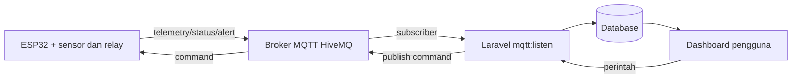

# Dokumentasi Lengkap Smart Socket

Dokumen ini menjelaskan cara menyiapkan, menjalankan, menggunakan, dan memasang Smart Socket: firmware ESP32, broker MQTT, aplikasi Laravel, database, serta dashboard web.

> **Ruang lingkup:** dokumentasi mengikuti isi repository saat ini. Nama host, username, password, token, dan alamat IP produksi harus diisi melalui environment atau portal perangkat; jangan menyalin kredensial ke source code.

## 1. Gambaran sistem

Smart Socket memonitor dua kanal listrik secara terpisah dan dapat memutus relay melalui perintah dari dashboard.

- **ESP32** membaca dua PZEM-004T, DS18B20, dan MQ-2.
- **ESP32** mengirim telemetri dan alarm ke broker MQTT melalui TLS.
- **Laravel** menjalankan subscriber `mqtt:listen` untuk menyimpan data ke database.
- **Dashboard Laravel** menampilkan data, mengubah relay, mengatur ambang proteksi, mengekspor riwayat, dan mereset energi.
- **MQTT** menjadi perantara komunikasi dua arah; server tidak perlu membuka koneksi langsung ke ESP32.



Dokumen teknis yang lebih ringkas tersedia di [ringkasan-sistem.md](./ringkasan-sistem.md), [implementasi-laravel.md](./implementasi-laravel.md), dan [implementasi-firmware.md](./implementasi-firmware.md).

## 2. Struktur folder penting

| Lokasi | Kegunaan |
|---|---|
| `app/Http/Controllers/` | Dashboard, analitik, riwayat, pengaturan, profil |
| `app/Services/MqttService.php` | Koneksi dan publish MQTT dari Laravel |
| `app/Console/Commands/MqttListenCommand.php` | Subscriber MQTT dan penyimpanan telemetri |
| `app/Models/` | Model Eloquent perangkat, kanal, log, dan alarm |
| `database/migrations/` | Struktur tabel database |
| `resources/views/` | Tampilan Blade |
| `routes/web.php` | Rute halaman dan API internal |
| `firmware/smartsocket/smartsocket.ino` | Program utama ESP32 |
| `firmware/smartsocket/config_portal.h` | Portal konfigurasi WiFi/MQTT pada ESP32 |
| `deploy/supervisor/` | Contoh konfigurasi proses subscriber di server |
| `docs/` | Dokumentasi teknis, pengujian, dan diagram |

## 3. Persyaratan perangkat lunak

### 3.1 Komputer lokal Windows/VS Code

- Visual Studio Code.
- PHP **8.3 atau lebih baru** dan ekstensi yang dibutuhkan Laravel.
- Composer.
- Node.js dan npm.
- Git (opsional tetapi disarankan).
- Arduino IDE 2.x atau PlatformIO untuk firmware.
- Driver USB-UART yang sesuai dengan board ESP32.

Versi package utama backend ditentukan oleh [composer.json](../composer.json): Laravel 13, `php-mqtt/client`, Breeze, Vite, dan PHP Unit.

### 3.2 Server Linux

- PHP 8.3+, Composer, Node.js/npm untuk proses build.
- Nginx atau Apache dengan document root ke folder `public/`.
- SQLite untuk instalasi kecil, atau database server yang didukung Laravel.
- Broker MQTT yang dapat dijangkau melalui TLS port 8883.
- Supervisor atau systemd agar subscriber tetap berjalan.
- HTTPS untuk dashboard produksi.

## 4. Setup lokal di VS Code

### 4.1 Membuka proyek

Buka folder `smartsocket`, bukan folder `vendor` atau `storage`:

```powershell
Set-Location 'C:\Users\ACER\Documents\to upload\PROYEK\WILDA\smartsocket'
code .
```

Jika memakai repository Git:

```powershell
git clone <URL_REPOSITORY> 'C:\path\smartsocket'
Set-Location 'C:\path\smartsocket'
```

### 4.2 Instalasi dependency Laravel dan frontend

```powershell
composer install
Copy-Item .env.example .env
php artisan key:generate
npm install
```

Jika `.env` sudah ada, jangan menimpanya. File `.env` berisi rahasia dan tidak boleh di-commit.

### 4.3 Database lokal

Konfigurasi paling sederhana menggunakan SQLite:

```powershell
New-Item -ItemType File -Force database\database.sqlite
```

Atur `.env`:

```dotenv
APP_ENV=local
APP_DEBUG=true
APP_URL=http://127.0.0.1:8000
DB_CONNECTION=sqlite
DB_DATABASE=database/database.sqlite
```

Jalankan migrasi dan data awal:

```powershell
php artisan migrate
php artisan db:seed
```

Seeder membuat akun awal sesuai kode aplikasi. **Segera ganti password melalui fitur profil setelah login pertama.** Jangan menulis password awal di dokumentasi produksi.

### 4.4 Konfigurasi MQTT Laravel

Isi nama variabel berikut di `.env`; nilai sebenarnya berasal dari operator broker:

```dotenv
MQTT_HOST=<broker-host>
MQTT_PORT=8883
MQTT_TLS=true
MQTT_AUTH_USERNAME=<mqtt-username>
MQTT_AUTH_PASSWORD=<mqtt-password>
MQTT_CLIENT_ID=laravel_backend_daemon
MQTT_TIMEOUT=10
DEFAULT_DEVICE_UID=<device-uid-yang-sama-dengan-ESP32>
```

Konfigurasi dibaca oleh [config/mqtt.php](../config/mqtt.php). Kredensial khusus perangkat dapat disimpan melalui halaman Settings dan digunakan oleh `MqttService`.

### 4.5 Menjalankan aplikasi lokal

Terminal 1, server Laravel:

```powershell
php artisan serve --host=127.0.0.1 --port=8000
```

Terminal 2, build asset saat pengembangan:

```powershell
npm run dev
```

Terminal 3, subscriber MQTT:

```powershell
php artisan mqtt:listen --device=<device-uid>
```

Buka `http://127.0.0.1:8000`. Login, kemudian buka Dashboard. Subscriber harus aktif agar telemetri masuk ke database. Tekan `Ctrl+C` untuk menghentikan proses foreground.

### 4.6 Perintah pemeriksaan lokal

```powershell
php artisan route:list
php artisan migrate:status
php artisan test
npm run build
```

Jika ingin menjalankan satu proses development sesuai script Composer, periksa hasil `composer run dev`; proses tersebut dapat menjalankan server, queue, log, dan Vite secara bersamaan sesuai definisi script proyek.

## 5. Instalasi ke server Linux

Contoh berikut memakai `/var/www/smartsocket`. Sesuaikan user, domain, dan service dengan server.

### 5.1 Menyalin source dan dependency

```bash
sudo mkdir -p /var/www/smartsocket
sudo chown -R "$USER":"$USER" /var/www/smartsocket
cd /var/www/smartsocket
# clone atau salin source aplikasi ke folder ini
composer install --no-dev --optimize-autoloader
npm ci
npm run build
cp .env.example .env
php artisan key:generate
```

### 5.2 Environment produksi

Contoh minimal:

```dotenv
APP_NAME="Smart Socket"
APP_ENV=production
APP_DEBUG=false
APP_URL=https://smart-socket.example
APP_KEY=<hasil-php-artisan-key-generate>
DB_CONNECTION=sqlite
DB_DATABASE=/var/www/smartsocket/database/database.sqlite
SESSION_DRIVER=database
CACHE_STORE=database
QUEUE_CONNECTION=database
MQTT_HOST=<broker-host>
MQTT_PORT=8883
MQTT_TLS=true
MQTT_AUTH_USERNAME=<mqtt-username>
MQTT_AUTH_PASSWORD=<mqtt-password>
MQTT_CLIENT_ID=laravel_backend_daemon_server
MQTT_TIMEOUT=10
DEFAULT_DEVICE_UID=<device-uid>
```

Buat database SQLite jika digunakan, lalu migrasi:

```bash
mkdir -p database storage/logs
touch database/database.sqlite
php artisan migrate --force
php artisan db:seed --force
php artisan storage:link
php artisan config:cache
php artisan route:cache
php artisan view:cache
```

Untuk database MySQL/PostgreSQL, isi `DB_*` sesuai server dan jalankan perintah migrasi yang sama. Pastikan user web dapat menulis `storage/` dan `bootstrap/cache/`:

```bash
sudo chown -R www-data:www-data storage bootstrap/cache
sudo chmod -R ug+rwX storage bootstrap/cache
```

### 5.3 Web server

Document root **wajib** menunjuk ke `/var/www/smartsocket/public`, bukan root proyek. Contoh konsep Nginx:

```nginx
server {
    listen 80;
    server_name smart-socket.example;
    root /var/www/smartsocket/public;
    index index.php;

    location / {
        try_files $uri $uri/ /index.php?$query_string;
    }

    location ~ \.php$ {
        include snippets/fastcgi-php.conf;
        fastcgi_pass unix:/run/php/php8.3-fpm.sock;
    }
}
```

Aktifkan site dan HTTPS menggunakan prosedur distro/server yang dipakai. Jangan mengekspos folder `.env`, `vendor`, atau root proyek sebagai file statis.

### 5.4 Menjalankan subscriber sebagai service

File [deploy/supervisor/smartsocket-mqtt.conf](../deploy/supervisor/smartsocket-mqtt.conf) adalah referensi Supervisor. Sesuaikan `directory`, `command`, `user`, dan `environment` dengan server. Pola perintahnya:

```bash
php /var/www/smartsocket/artisan mqtt:listen --device=<device-uid>
```

Setelah konfigurasi Supervisor:

```bash
sudo supervisorctl reread
sudo supervisorctl update
sudo supervisorctl status smartsocket-mqtt
```

Periksa `storage/logs/laravel.log` dan log Supervisor bila status tidak `RUNNING`. Subscriber harus berjalan terus karena menerima telemetri dan status MQTT.

### 5.5 Checklist setelah deploy

1. `APP_DEBUG=false` dan `APP_URL` memakai domain HTTPS.
2. `php artisan migrate:status` berhasil.
3. Dashboard dapat login.
4. Worker `mqtt:listen` berstatus aktif.
5. Device UID database sama persis dengan UID di portal ESP32.
6. Broker menerima koneksi TLS dari server dan ESP32.
7. Telemetri membuat `last_seen_at` perangkat berubah.
8. Toggle relay dari dashboard menghasilkan `mqtt_delivered=true` bila publish berhasil.
9. Tidak ada password/token di Git atau log.

## 6. Instalasi dan penggunaan firmware ESP32

### 6.1 Isi folder firmware

Sketch utama terdiri dari dua file yang harus berada dalam folder sketch yang sama:

- `firmware/smartsocket/smartsocket.ino`
- `firmware/smartsocket/config_portal.h`

File `platformio.ini` tidak tersedia pada folder firmware saat ini. Karena itu, gunakan Arduino IDE dengan konfigurasi board/library yang sesuai, atau buat proyek PlatformIO setelah menetapkan board ESP32 yang digunakan. **TODO: konfirmasi tipe board ESP32 dan port USB final.**

### 6.2 Library yang digunakan

Import pada sketch menunjukkan library berikut:

| Library | Fungsi |
|---|---|
| `WiFi` | Koneksi station dan reconnect WiFi |
| `WiFiClientSecure` | Transport TLS MQTT |
| `PubSubClient` | Client MQTT dan callback pesan |
| `ArduinoJson` | Serialisasi/deserialisasi JSON |
| `PZEM004Tv30` | Pembacaan dua PZEM-004T v3.0 |
| `OneWire`, `DallasTemperature` | DS18B20 |
| `Wire`, `LiquidCrystal_I2C` | LCD 16x2 I2C |
| `Preferences` | Penyimpanan NVS ESP32 |
| `WebServer`, `DNSServer` | Portal konfigurasi lokal |

Pasang library dari Library Manager Arduino IDE atau dependency manager PlatformIO. Versi library tidak dipatok di sketch; gunakan versi yang kompatibel dengan Arduino Core ESP32 dan lakukan uji upload sebelum produksi.

### 6.3 Pin mapping

| Komponen | GPIO |
|---|---:|
| Relay socket 1 | 18 |
| Relay socket 2 | 19 |
| DS18B20 data | 5 |
| MQ-2 analog | 34 |
| PZEM 1 RX/TX | 16 / 17 |
| PZEM 2 RX/TX | 26 / 27 |
| LCD SDA/SCL | 21 / 22 |
| Tombol BOOT paksa AP | GPIO0 |

Pastikan rangkaian listrik AC, isolasi, fuse, grounding, dan enclosure dikerjakan oleh teknisi yang kompeten. Dokumentasi software tidak menggantikan standar keselamatan listrik.

### 6.4 Build dan flash dengan Arduino IDE

1. Instal Arduino IDE dan ESP32 board package.
2. Buka `smartsocket.ino`; Arduino IDE akan meminta folder sketch.
3. Pastikan `config_portal.h` berada di folder yang sama.
4. Pilih board ESP32 yang benar dan port USB.
5. Pasang library pada tabel di atas.
6. Klik **Verify**, lalu **Upload**.
7. Buka Serial Monitor pada **115200 baud**.
8. Jika upload berhenti pada `Connecting...`, tahan tombol BOOT saat board mulai upload.

Contoh alur penggunaan setelah flash:

1. Nyalakan ESP32 tanpa WiFi tersimpan, atau tahan GPIO0 selama sekitar 3 detik saat boot.
2. ESP32 membuka AP setup; sambungkan laptop/HP ke SSID `SmartSocket-...`.
3. Buka alamat portal yang tampil pada LCD/Serial Monitor.
4. Login dengan user `admin` dan password portal yang telah dikonfigurasi. Ganti password bawaan sebelum penggunaan nyata.
5. Isi SSID/password WiFi, host/port MQTT, username/password MQTT, client ID, Device UID, NTP, dan GMT offset.
6. Simpan konfigurasi; perangkat melakukan restart.
7. Daftarkan Device UID yang sama pada database Laravel/user.
8. Jalankan subscriber Laravel dan amati telemetri di Dashboard.

Portal menyimpan konfigurasi pada NVS namespace `config`. Status relay dan threshold juga disimpan pada NVS, sehingga penghapusan/flash dengan opsi erase dapat menghapus konfigurasi tersebut.

### 6.5 Alur kode firmware

- `setup()` memuat NVS, mengembalikan status relay, memuat threshold, menyiapkan pin/sensor/LCD, membentuk topik MQTT, memulai WiFi/NTP, portal, dan MQTT TLS.
- `loop()` melayani portal, menjaga koneksi, membaca sensor setiap 1 detik, mengevaluasi proteksi, mengirim telemetri pada interval dinamis, mengirim heartbeat 30 detik, dan memperbarui LCD.
- WiFi dicoba ulang setiap 10 detik; MQTT setiap 5 detik.
- Telemetri default dikirim setiap 5 detik dan dapat diubah melalui command threshold dengan rentang 1–3600 detik.
- Alarm dibatasi cooldown sekitar 30 detik untuk mencegah banjir pesan.

Peta fungsi utama pada [smartsocket.ino](../firmware/smartsocket/smartsocket.ino):

| Fungsi | Tanggung jawab |
|---|---|
| `setup()` | Inisialisasi hardware, NVS, WiFi, portal, topik, dan MQTT. |
| `loop()` | Scheduler non-blocking berbasis `millis()` untuk seluruh pekerjaan periodik. |
| `checkWifiAndMqtt()` | Reconnect WiFi/MQTT tanpa menunggu lama pada setiap iterasi loop. |
| `connectMqtt()` | Login broker, memasang LWT/status, dan subscribe command. |
| `mqttCallback()` | Parse JSON lalu meneruskan pesan ke handler command sesuai topik. |
| `processSwitchCommand()` | Mengubah relay; menolak ON ketika lockout proteksi aktif. |
| `processThresholdCommand()` | Memperbarui threshold dan interval telemetri, lalu menyimpan ke NVS. |
| `readAllSensors()` | Membaca PZEM 1/2, DS18B20, MQ-2, dan mengisi `latestSensor`. |
| `publishTelemetry()` | Membentuk JSON baku dan publish ke topic telemetry. |
| `evaluateThresholds()` | Menilai overvoltage, overcurrent, asap, suhu, dan melakukan cutoff. |
| `sendAlert()` | Membentuk alarm JSON dan mengirimkannya dengan cooldown. |
| `publishStatus()` | Mengirim status online/offline retained sesuai kode firmware. |

Pola `millis()` dipakai agar pembacaan sensor, komunikasi, portal, dan LCD dapat berjalan bersamaan. Fungsi pembacaan yang memang membutuhkan waktu sangat singkat, seperti sampling MQ-2 dan reset PZEM, tetap menggunakan delay mikro/milidetik sebagaimana implementasi source.

### 6.6 Topik MQTT dan payload

`{UID}` harus diganti dengan Device UID yang sama pada firmware dan database.

| Arah | Topik | QoS/retain di kode |
|---|---|---|
| ESP32 → broker | `smartsocket/{UID}/telemetry` | publish non-retained |
| ESP32 → broker | `smartsocket/{UID}/status` | status/LWT QoS 1, retained |
| ESP32 → broker | `smartsocket/{UID}/alert` | publish alert |
| Laravel → ESP32 | `smartsocket/{UID}/command/switch` | subscribe QoS 1 |
| Laravel → ESP32 | `smartsocket/{UID}/command/switch/sync` | sinkronisasi awal |
| Laravel → ESP32 | `smartsocket/{UID}/command/threshold` | QoS 1, retained dari server |
| Laravel → ESP32 | `smartsocket/{UID}/command/reconnect` | QoS 1 |
| Laravel → ESP32 | `smartsocket/{UID}/command/reset_energy` | QoS 1 |

Contoh telemetry, tanpa nilai rahasia:

```json
{
  "device_id": "<UID>",
  "timestamp": 1720000000,
  "environmental": {"temperature": 30.5, "smoke_ppm": 120},
  "sockets": {
    "socket_1": {"relay_state": "ON", "voltage": 220.1, "current": 1.2, "power": 250.0, "energy": 0.123, "frequency": 50.0, "power_factor": 0.95},
    "socket_2": {"relay_state": "OFF", "voltage": 0, "current": 0, "power": 0, "energy": 0, "frequency": 0, "power_factor": 0}
  }
}
```

Contoh command:

```json
{"socket_number":1,"state":"ON"}
```

```json
{"max_voltage":245,"max_current":15.5,"max_temperature":65,"max_smoke_ppm":995,"device_interval":5}
```

```json
{"socket_number":0}
```

`socket_number` pada reset energi bernilai `1`, `2`, atau `0` untuk keduanya.

### 6.7 Proteksi keselamatan

- Tegangan melewati threshold: kedua relay dimatikan.
- Arus melewati threshold: relay kanal yang overload dimatikan.
- Asap melewati threshold: kedua relay dimatikan.
- Suhu melewati threshold: alarm dikirim; kedua relay dimatikan bila suhu minimal 10°C di atas threshold.
- Saat `isTripped`, perintah ON ditolak sampai kondisi tertentu kembali normal.

Firmware saat ini menggunakan `setInsecure()` untuk TLS ESP32, dan service server menonaktifkan verifikasi peer TLS. Ini memudahkan kompatibilitas tetapi **belum ideal untuk produksi**; gunakan CA certificate dan aktifkan verifikasi sertifikat pada deployment nyata.

## 7. Komponen kode Laravel

| Komponen | Peran |
|---|---|
| `DashboardController` | Dashboard, toggle relay, reconnect, telemetri, notifikasi. |
| `SettingsController` | Threshold, interval, tarif, kredensial MQTT, reset energi. |
| `HistoryController` | Riwayat dan ekspor CSV. |
| `AnalyticsController` | Agregasi statistik daya/energi. |
| `MqttService` | Membuat client MQTT TLS dan publish command QoS 1. |
| `MqttListenCommand` | Subscribe telemetry/status/alert, parse JSON, dan menyimpan data secara transaction. |
| Model Eloquent | Relasi `User`–`Device`–`SocketChannel` serta log, alert, threshold, dan aktivitas. |
| Form Request | Validasi pengaturan device dan MQTT sebelum controller memproses data. |

Alur publish dari UI adalah: request terautentikasi → validasi → controller mengambil device milik user → service membentuk topic/payload → broker menerima publish → controller mengembalikan status `mqtt_delivered`. Alur masuk adalah: broker → `mqtt:listen` → validasi JSON → transaksi database → dashboard membaca data terbaru.

## 8. Cara menggunakan aplikasi

1. Login ke `/login`.
2. **Dashboard**: lihat tegangan, arus, daya, energi, suhu, asap, status relay, dan alarm; gunakan toggle untuk mengendalikan socket.
3. **Analytics**: pilih periode agregasi daya/energi.
4. **History**: filter tanggal/socket, ekspor CSV, atau reset log bila memang diperlukan.
5. **Settings**: simpan threshold, tarif kWh, interval log/device, konfigurasi MQTT, dan reset energi PZEM.
6. **About**: lihat informasi sistem.
7. **Profile**: ubah data akun dan password.

Semua rute operasional pada [routes/web.php](../routes/web.php) dilindungi middleware `auth`.

## 9. Troubleshooting

| Gejala | Pemeriksaan |
|---|---|
| Dashboard kosong | Pastikan `mqtt:listen` berjalan, UID sama, dan worker dapat terhubung ke broker. |
| `mqtt_delivered=false` | Periksa host/port, kredensial, TLS, firewall outbound 8883, dan log Laravel. |
| ESP32 terus reconnect | Periksa SSID/password, RSSI, DNS, waktu NTP, dan daya board. |
| Portal tidak muncul | Tahan GPIO0 saat power-on; pastikan WiFi belum tersimpan atau perangkat gagal tersambung. |
| Nilai PZEM nol | Periksa UART RX/TX, alamat/koneksi PZEM, common ground, dan jalur pengukuran. |
| Alarm terus muncul | Periksa threshold, kalibrasi MQ-2, sensor DS18B20, dan cooldown alarm. |
| Worker berhenti | Jalankan foreground untuk melihat exception, lalu periksa Supervisor dan `storage/logs/laravel.log`. |
| Asset tidak berubah | Jalankan `npm run build`, hapus cache view/config bila perlu, lalu refresh browser. |

## 10. Referensi dan TODO konfirmasi

- [README.md](../README.md) — quick start proyek.
- [implementasi-laravel.md](./implementasi-laravel.md) — controller, route, model, dan MQTT.
- [implementasi-firmware.md](./implementasi-firmware.md) — ringkasan firmware.
- [pengujian.md](./pengujian.md) — template pengujian.
- [perancangan.md](./perancangan.md) — diagram dan rancangan sistem.

TODO yang perlu dikonfirmasi sebelum rilis:

1. Tipe board ESP32 dan nomor port USB untuk prosedur flash standar.
2. Versi pasti Arduino Core dan library firmware yang dipakai pada build final.
3. Domain, web server, PHP-FPM, dan database produksi.
4. CA certificate MQTT dan kebijakan verifikasi TLS produksi.
5. Password akun/portal awal dan prosedur rotasinya.
6. Kalibrasi MQ-2 dan batas keselamatan yang disetujui teknisi.
