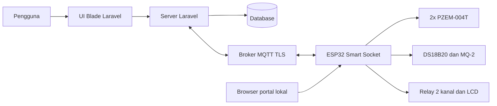
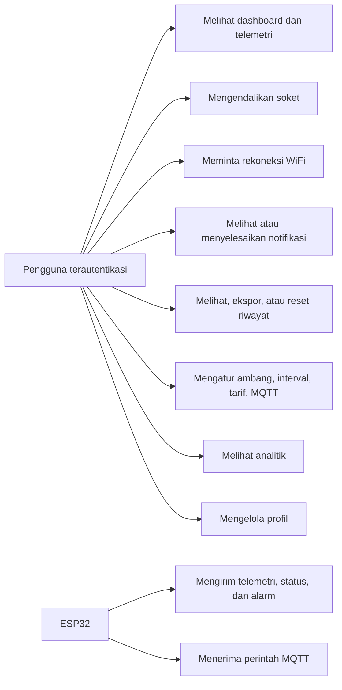
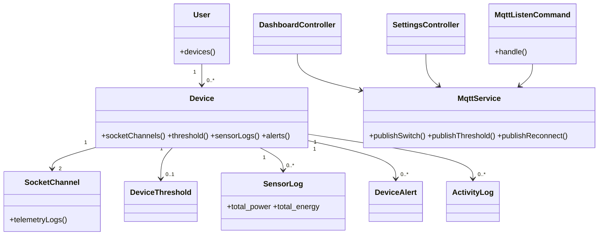
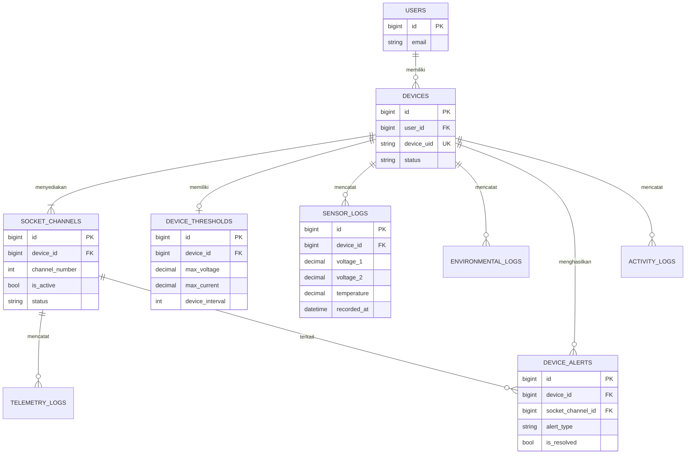
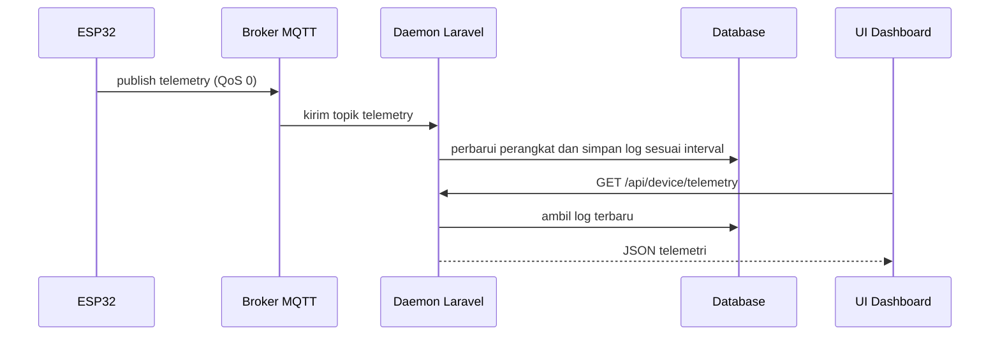
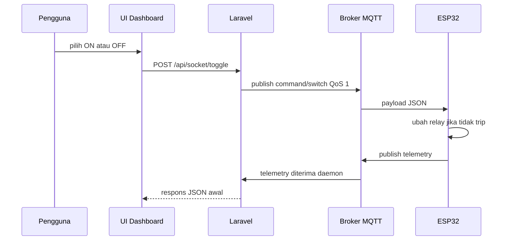
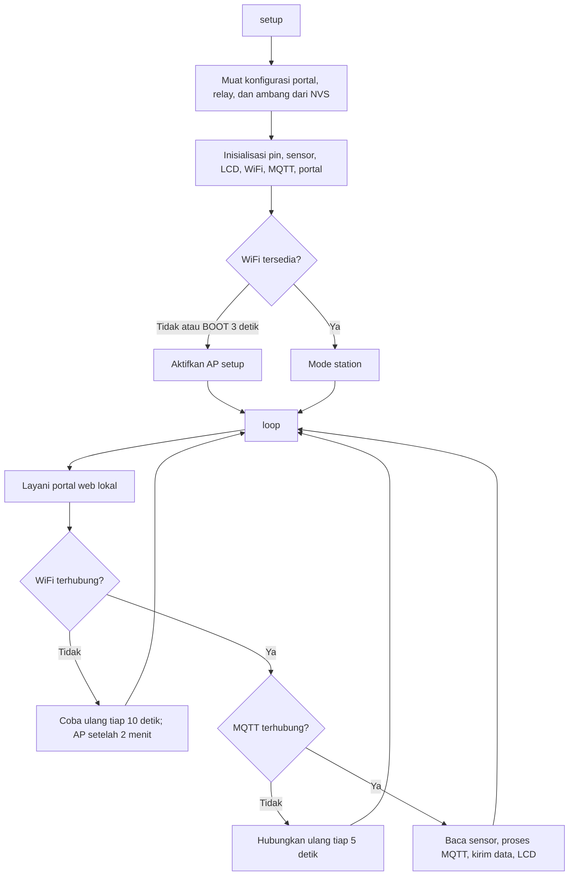
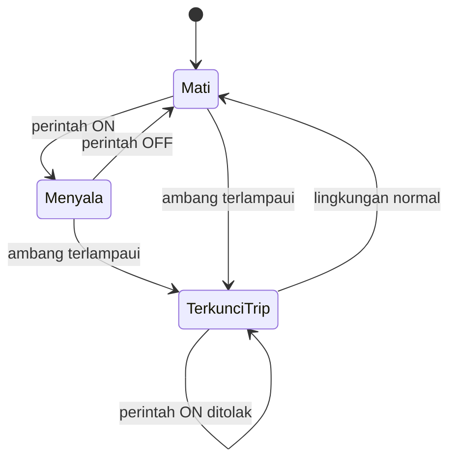

# Perancangan Sistem

Diagram sumber ada di `docs/diagram/`; blok berikut sengaja sama agar dapat dirender oleh pembaca Markdown.

## Arsitektur/deployment

## Use case

## Kelas Laravel

## ERD

## Urutan telemetri

## Urutan kontrol

## Alur firmware

## State relay

## Pin mapping dan komponen

| Komponen | Pin/antarmuka | Fungsi |
|---|---|---|
| Relay soket 1 | GPIO 18 | Keluaran relay 1 |
| Relay soket 2 | GPIO 19 | Keluaran relay 2 |
| DS18B20 | GPIO 5 / OneWire | Suhu enclosure |
| MQ-2 | GPIO 34 / ADC | Asap/gas |
| PZEM-1 | RX 16, TX 17, UART1 | Metrik soket 1 |
| PZEM-2 | RX 26, TX 27, UART2 | Metrik soket 2 |
| LCD I2C | SDA 21, SCL 22, alamat 0x27 | Tampilan lokal |

Catatan: kode menetapkan `RELAY_ACTIVE_LOW` bernilai `false`; sesuaikan dengan modul relay fisik bila diperlukan.
