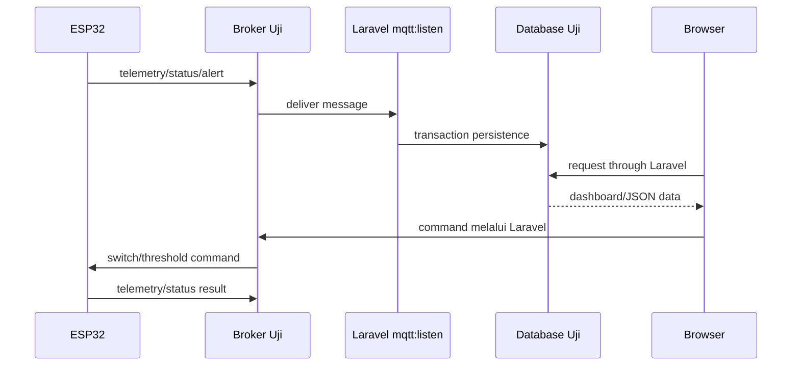

# Dokumen 3 — Rencana & Hasil Pengujian

**Nama sistem:** Smart Socket IoT Management Platform  
**Instansi/klien:** ⚠️ PERLU KONFIRMASI: nama instansi atau perusahaan.  
**Versi dokumen:** 1.0  
**Tanggal penyusunan:** 18 Oktober 2026  
**Penyusun:** ⚠️ PERLU KONFIRMASI: nama penyusun.  
**Status:** Rencana pengujian dan template hasil.  

> Kolom **Hasil aktual**, **Status**, dan **Bukti** hanya diisi setelah pengujian benar-benar dilaksanakan. Dokumen ini tidak mengklaim pengujian yang belum dijalankan.

## Daftar Isi

1. [Pendahuluan](#1-pendahuluan)
2. [Strategi Pengujian](#2-strategi-pengujian)
3. [Lingkungan Pengujian](#3-lingkungan-pengujian)
4. [Matriks dan Test Case](#4-matriks-dan-test-case)
5. [Pengujian Firmware dan Integrasi Hardware](#5-pengujian-firmware-dan-integrasi-hardware)
6. [Pengujian Non-Fungsional](#6-pengujian-non-fungsional)
7. [Kriteria Kelulusan dan Rilis](#7-kriteria-kelulusan-dan-rilis)
8. [Ringkasan Hasil](#8-ringkasan-hasil)
9. [Checklist Kelengkapan](#9-checklist-kelengkapan)

---

## 1. Pendahuluan

### 1.1 Tujuan

Dokumen ini menetapkan strategi, skenario, data uji, hasil yang diharapkan, dan format pencatatan hasil pengujian Smart Socket. Cakupan pengujian diturunkan dari requirement pada [SKPL](./SKPL.md), rancangan pada [DPPL](./DPPL.md), route Laravel, migration, test PHPUnit yang tersedia, dan firmware `smartsocket.ino`.

### 1.2 Ruang lingkup

Pengujian mencakup:

- Autentikasi dan pembatasan akses route Laravel.
- Dashboard, endpoint telemetry, kontrol relay, reconnect, dan notifikasi.
- Settings threshold, interval, tarif, credential MQTT, serta reset energi.
- History, export CSV, dan reset log.
- Persistence database dan relasi device/socket/log.
- MQTT publish dari Laravel dan subscribe/persistence pada worker.
- Firmware ESP32: pembacaan sensor, relay, proteksi, command, reconnect, portal, dan NVS.
- Integrasi end-to-end ESP32 → broker → worker Laravel → database → dashboard.
- Keamanan konfigurasi dan rahasia.

OTA, watchdog khusus, konsumsi daya, SLA, scalability, dan pengujian produksi belum dapat dinyatakan sebagai selesai karena implementasi atau target ukur belum tersedia. **⚠️ PERLU KONFIRMASI:** target penerimaan untuk area tersebut.

### 1.3 Referensi teknis

- [SKPL](./SKPL.md)
- [DPPL](./DPPL.md)
- [Panduan lengkap](./panduan-lengkap.md)
- [Routes web](../routes/web.php)
- [SmartSocketTest](../tests/Feature/SmartSocketTest.php)
- [AuthenticationTest](../tests/Feature/Auth/AuthenticationTest.php)
- [MqttService](../app/Services/MqttService.php)
- [MqttListenCommand](../app/Console/Commands/MqttListenCommand.php)
- [Firmware utama](../firmware/smartsocket/smartsocket.ino)
- [Portal konfigurasi](../firmware/smartsocket/config_portal.h)

---

## 2. Strategi Pengujian

### 2.1 Level pengujian

| Level | Tujuan | Objek | Tools/metode |
|---|---|---|---|
| Unit | Memeriksa fungsi atau aturan kecil secara terisolasi. | Accessor model, kalkulasi sensor, helper, parser payload. | PHPUnit/Pest sesuai konfigurasi repository, mock `MqttService`. |
| Feature | Memeriksa alur HTTP, middleware, controller, database, dan response. | Route auth, dashboard, settings, history, profile. | `php artisan test`, `RefreshDatabase`, SQLite in-memory. |
| Integrasi backend–MQTT | Memeriksa publish dan subscribe terhadap broker uji. | `MqttService`, `mqtt:listen`, topic dan payload. | Broker MQTT uji, log worker, database uji. |
| Integrasi hardware | Memeriksa hubungan ESP32, sensor, relay, LCD, dan broker. | Firmware, wiring, sensor, aktuator. | ESP32 aktual, multimeter/clamp meter, sumber beban terkontrol, broker uji. |
| Black-box | Memeriksa perilaku dari sisi pengguna tanpa melihat implementasi internal. | Dashboard, settings, history, portal ESP32. | Browser, HTTP client, prosedur manual. |
| UAT | Memastikan sistem memenuhi kebutuhan pengguna yang disepakati. | Skenario operasional end-to-end. | Checklist penerimaan dan tanda tangan pemangku kepentingan. |

### 2.2 Pendekatan eksekusi

1. Jalankan test otomatis backend menggunakan database SQLite in-memory.
2. Jalankan migration dan seeder pada environment lokal terisolasi.
3. Uji endpoint authenticated dan guest dengan browser/HTTP client.
4. Jalankan broker uji menggunakan credential placeholder, bukan credential produksi.
5. Flash firmware pada perangkat uji dengan konfigurasi non-produksi.
6. Jalankan worker MQTT dengan satu device UID uji.
7. Kirim payload normal, invalid, boundary, dan alarm.
8. Cocokkan hasil dashboard, database, log worker, relay, dan sensor.
9. Dokumentasikan hasil aktual, waktu uji, tester, firmware version, commit/source version, dan bukti.

### 2.3 Klasifikasi status

| Status | Arti |
|---|---|
| `PASS` | Hasil aktual memenuhi seluruh hasil yang diharapkan. |
| `FAIL` | Hasil aktual tidak memenuhi hasil yang diharapkan. |
| `BLOCKED` | Tidak dapat diuji karena prasyarat atau alat belum tersedia. |
| `NOT RUN` | Belum dilaksanakan. |
| `N/A` | Tidak berlaku setelah disetujui dan diberi alasan. |

### 2.4 Aturan data uji

- Gunakan `DEVICE_UID` dan host broker placeholder/non-produksi.
- Jangan masukkan password WiFi, MQTT, private key, atau token asli ke dokumen hasil.
- Gunakan dua device hanya bila skenario otorisasi membutuhkan isolasi pemilik.
- Untuk threshold, gunakan nilai uji yang aman dan beban listrik terkontrol.
- Jangan menguji kondisi asap, suhu, atau listrik berbahaya tanpa prosedur keselamatan dan alat laboratorium yang sesuai.

---

## 3. Lingkungan Pengujian

### 3.1 Environment backend lokal

| Komponen | Nilai yang dipersyaratkan |
|---|---|
| OS | Windows lokal untuk development atau Linux server uji. Versi spesifik: ⚠️ PERLU KONFIRMASI. |
| PHP | `^8.3`. |
| Laravel | `^13.17`. |
| Database otomatis | SQLite in-memory untuk PHPUnit. |
| Database integrasi | SQLite/MySQL sesuai environment uji. Jenis final: ⚠️ PERLU KONFIRMASI. |
| Browser | Browser modern. Nama/version: ⚠️ PERLU KONFIRMASI. |
| MQTT library | `php-mqtt/client ^2.3` dan `php-mqtt/laravel-client`. |
| Build frontend | Vite melalui `npm run build`. |

### 3.2 Environment firmware

| Komponen | Konfigurasi dari source |
|---|---|
| Microcontroller | ESP32; model board spesifik perlu dikonfirmasi. |
| Firmware | Versi source `2.6.0`. |
| Sensor listrik | Dua PZEM-004T v3.0. |
| Sensor lingkungan | DS18B20 dan MQ-2. |
| Aktuator | Relay dua kanal dan LCD 16x2 I2C. |
| Broker | MQTT TLS; endpoint aktual memakai placeholder. |
| Serial/log | Serial Monitor; baud rate final: ⚠️ PERLU KONFIRMASI. |
| Instrumentasi | Multimeter/clamp meter, thermometer/reference sensor, alat uji asap/gas terkontrol. |

### 3.3 Prasyarat eksekusi

- Dependency Composer dan npm berhasil terpasang.
- `.env` testing/lokal tersedia dan tidak berisi secret produksi.
- Migration berhasil dijalankan.
- User uji dan device uji tersedia.
- Broker MQTT uji aktif bila menjalankan integrasi.
- `config_portal.h` tersedia di folder sketch.
- Wiring diverifikasi sebelum perangkat diberi daya.
- Backup database uji dibuat sebelum skenario reset destruktif.

---

## 4. Matriks dan Test Case

### 4.1 Test otomatis yang sudah tersedia di repository

`tests/Feature/SmartSocketTest.php` menunjukkan cakupan otomatis berikut. Status eksekusi pada dokumen ini tetap `NOT RUN` sampai command test dijalankan pada environment saat ini.

| ID | Test otomatis | Tujuan |
|---|---|---|
| AT-001 | `test_guest_is_redirected_to_login` | Guest diarahkan ke login. |
| AT-002 | `test_user_can_access_dashboard_and_views` | User authenticated mengakses halaman operasional. |
| AT-003 | `test_socket_toggle_endpoint` | Endpoint toggle mengubah state socket. |
| AT-004 | `test_telemetry_polling_endpoint` | Endpoint telemetry mengembalikan struktur default. |
| AT-005 | `test_settings_update` | Settings threshold disimpan. |
| AT-006 | `test_history_csv_export` | Export history memiliki content type CSV. |
| AT-007 | `test_user_can_update_own_mqtt_credentials` | Credential MQTT milik user disimpan terenkripsi. |
| AT-008 | `test_user_cannot_read_or_control_another_users_device` | User tidak mengontrol device user lain. |

Test auth/profile tambahan berada pada folder `tests/Feature/Auth/` dan `tests/Feature/ProfileTest.php`.

### 4.2 Test case fungsional aplikasi

| ID | Fitur | Skenario/data uji | Hasil yang diharapkan | Hasil aktual | Status | Bukti |
|---|---|---|---|---|---|---|
| TC-001 | Root/auth | GET `/` sebagai guest | Redirect ke `/login`. |  | NOT RUN |  |
| TC-002 | Root/auth | GET `/dashboard` sebagai guest | Middleware mengarahkan ke login. |  | NOT RUN |  |
| TC-003 | Dashboard | GET `/dashboard` sebagai user dengan device | HTTP 200 dan halaman dashboard tampil. |  | NOT RUN |  |
| TC-004 | Navigasi | GET `/analytics`, `/history`, `/settings`, `/about` authenticated | Seluruh halaman mengembalikan HTTP 200. |  | NOT RUN |  |
| TC-005 | Toggle relay | POST `/api/socket/toggle`, `socket_number=1`, `state=false` | Publish command dan state channel 1 tersimpan OFF. |  | NOT RUN |  |
| TC-006 | Isolasi device | User A mengontrol device user B | Operasi ditolak atau tidak mengubah device B. |  | NOT RUN |  |
| TC-007 | Telemetry endpoint | GET `/api/device/telemetry` tanpa data sensor | JSON berisi default nol dan status offline. |  | NOT RUN |  |
| TC-008 | Notifikasi | GET `/api/notifications` setelah alarm | Daftar alarm sesuai device authenticated. |  | NOT RUN |  |
| TC-009 | Resolve alert | POST `/api/notifications/resolve-all` | Alert user tersebut ditandai selesai. |  | NOT RUN |  |
| TC-010 | Settings threshold | POST `/settings` dengan nilai valid | Threshold tersimpan dan publish command threshold dilakukan. |  | NOT RUN |  |
| TC-011 | Validasi settings | POST `/settings` dengan nilai kosong/di luar range | Form ditolak dengan validation error dan data lama tidak rusak. |  | NOT RUN |  |
| TC-012 | MQTT settings | PUT `/settings/mqtt` dengan host, port, TLS, username, password, client ID placeholder | Data tersimpan; credential raw tidak sama dengan plaintext. |  | NOT RUN |  |
| TC-013 | Reset energi | POST `/settings/energy/reset` untuk socket 0, 1, dan 2 | Topic reset diterbitkan dengan pilihan socket yang benar. |  | NOT RUN |  |
| TC-014 | History | GET `/history` dengan rentang tanggal | Data hanya berasal dari rentang yang dipilih. |  | NOT RUN |  |
| TC-015 | Export | GET `/history/export` | Response stream berformat CSV dan header sesuai. |  | NOT RUN |  |
| TC-016 | Reset history | POST `/history/reset` | Log sesuai device dihapus dan aktivitas dicatat. |  | NOT RUN |  |
| TC-017 | Profile | PATCH `/profile` dengan data valid/invalid | Profil sendiri dapat diperbarui; input invalid ditolak. |  | NOT RUN |  |
| TC-018 | Authorization profile | DELETE `/profile` dengan password salah/benar | Password salah ditolak; password benar menjalankan alur Breeze. |  | NOT RUN |  |
| TC-019 | Guest API | GET/POST endpoint operasional tanpa session | Request tidak memperoleh data atau aksi operasional. |  | NOT RUN |  |
| TC-020 | Pagination/query | History dengan dataset besar | Query tetap sesuai batas/pagination yang diimplementasikan. |  | NOT RUN |  |

### 4.3 Test case MQTT worker dan kontrak pesan

| ID | Fitur | Skenario/data uji | Hasil yang diharapkan | Hasil aktual | Status | Bukti |
|---|---|---|---|---|---|---|
| TC-021 | MQTT connect | Broker uji tersedia, credential valid | Worker connect dan subscribe telemetry/status/alert. |  | NOT RUN |  |
| TC-022 | Telemetry normal | Payload nested dua socket + environmental | Device online, `last_seen_at`, channel, dan log diperbarui dalam transaction. |  | NOT RUN |  |
| TC-023 | Telemetry fallback | Payload field datar `voltage_1`, `current_1`, dst. | Parser fallback menghasilkan data yang benar. |  | NOT RUN |  |
| TC-024 | JSON invalid | Payload `{invalid` | `Log::warning`; worker tidak crash dan tetap listening. |  | NOT RUN |  |
| TC-025 | Device tidak dikenal | UID tidak terdaftar | Warning dicatat; tidak ada log salah pemilik. |  | NOT RUN |  |
| TC-026 | Timestamp invalid | Timestamp 0/uptime kecil | Worker menggunakan waktu server `now()`. |  | NOT RUN |  |
| TC-027 | Status/LWT | Publish status online/offline | Status device tersimpan sesuai payload. |  | NOT RUN |  |
| TC-028 | Alert | Publish alert overcurrent/smoke/temperature | `DeviceAlert` dan action terkait tersimpan. |  | NOT RUN |  |
| TC-029 | Reconnect worker | Broker diputus selama loop | Worker mencatat exception dan mencoba kembali setelah 5 detik. |  | NOT RUN |  |
| TC-030 | Publish failure | Host/port invalid atau broker unreachable | `MqttService` mengembalikan `false` dan log error. |  | NOT RUN |  |

### 4.4 Test case firmware

| ID | Fitur | Skenario/data uji | Hasil yang diharapkan | Hasil aktual | Status | Bukti |
|---|---|---|---|---|---|---|
| TC-031 | Boot normal | Power-on dengan WiFi/NVS valid | Firmware masuk station mode dan menjalankan loop. |  | NOT RUN |  |
| TC-032 | AP setup | GPIO0 ditahan sekitar 3 detik saat power-on | AP setup portal aktif. |  | NOT RUN |  |
| TC-033 | Portal auth | Buka portal tanpa/dengan Basic Authentication | Akses tanpa credential ditolak; credential valid diterima. |  | NOT RUN |  |
| TC-034 | Simpan portal | Isi WiFi, MQTT, UID, NTP, password portal valid | Data disimpan ke NVS dan konfigurasi diterapkan/restart sesuai implementasi. |  | NOT RUN |  |
| TC-035 | Validasi portal | SSID/host/UID kosong atau port di luar 1–65535 | Form ditolak dan konfigurasi valid sebelumnya tetap aman. |  | NOT RUN |  |
| TC-036 | Sensor PZEM | Beri beban terkontrol pada socket 1 dan 2 | Tegangan, arus, daya, energi, frekuensi, PF terbaca pada kanal yang benar. |  | NOT RUN |  |
| TC-037 | DS18B20/MQ-2 | Bandingkan pembacaan dengan alat/reference aman | Suhu dan smoke ppm masuk snapshot dengan toleransi yang disepakati. |  | NOT RUN |  |
| TC-038 | Relay | Command ON/OFF socket 1 dan 2 | GPIO dan state relay berubah sesuai command/polaritas. |  | NOT RUN |  |
| TC-039 | Sync relay | Device boot menerima `command/switch/sync` | State dua relay disinkronkan satu kali sesuai payload. |  | NOT RUN |  |
| TC-040 | Threshold voltage | Tegangan melewati `max_voltage` | Kedua relay dimatikan dan alert dikirim. |  | NOT RUN |  |
| TC-041 | Threshold current | Arus socket 1/2 melewati `max_current` | Relay socket yang overload dimatikan dan alert dikirim. |  | NOT RUN |  |
| TC-042 | Threshold smoke | Smoke melewati `max_smoke_ppm` | Kedua relay dimatikan dan alert dikirim. |  | NOT RUN |  |
| TC-043 | Threshold temperature | Suhu melewati aturan overtemperature | Alert dikirim; relay dimatikan sesuai aturan firmware. |  | NOT RUN |  |
| TC-044 | Lockout | Command ON saat `isTripped=true` | Command ON ditolak. |  | NOT RUN |  |
| TC-045 | Telemetry interval | Set `device_interval` 1, 5, dan 3600 | Publish mengikuti interval yang valid. |  | NOT RUN |  |
| TC-046 | Interval invalid | Set interval <1 atau >3600 | Firmware mempertahankan/default nilai sesuai implementasi validasi. |  | NOT RUN |  |
| TC-047 | Heartbeat | Jalankan lebih dari 30 detik | Status heartbeat diterbitkan secara berkala. |  | NOT RUN |  |
| TC-048 | Alert cooldown | Pertahankan satu kondisi alarm selama lebih dari 30 detik | Alarm sejenis tidak dikirim lebih sering dari cooldown. |  | NOT RUN |  |
| TC-049 | WiFi reconnect | Putuskan AP/WiFi | Firmware mencoba kembali setiap 10 detik. |  | NOT RUN |  |
| TC-050 | MQTT reconnect | Broker diputus | Firmware mencoba kembali setiap 5 detik. |  | NOT RUN |  |
| TC-051 | Reset energy | Command reset socket 0/1/2 | PZEM target di-reset sesuai pilihan dan hasil dapat diverifikasi. |  | NOT RUN |  |
| TC-052 | LCD | Jalankan operasi normal dan alarm | Halaman LCD berganti setiap 2,5 detik; kondisi alarm terlihat. |  | NOT RUN |  |

### 4.5 Test case keamanan

| ID | Area | Skenario/data uji | Hasil yang diharapkan | Hasil aktual | Status | Bukti |
|---|---|---|---|---|---|---|
| SEC-001 | Secret hygiene | Scan dokumentasi, `.env.example`, log, dan commit | Tidak ada credential produksi. |  | NOT RUN |  |
| SEC-002 | Auth boundary | Akses seluruh route operasional sebagai guest | Tidak ada akses data/aksi authenticated. |  | NOT RUN |  |
| SEC-003 | Ownership | User A mencoba device UID milik user B | Akses/control ditolak atau tidak memengaruhi B. |  | NOT RUN |  |
| SEC-004 | MQTT credential storage | Simpan username/password placeholder | Nilai database raw terenkripsi/berbeda dari plaintext dan tidak muncul normal response. |  | NOT RUN |  |
| SEC-005 | Input validation | Kirim tipe/string berbahaya dan nilai ekstrem | Request ditolak; tidak terjadi SQL/XSS/error disclosure. |  | NOT RUN |  |
| SEC-006 | TLS | Jalankan broker dengan certificate verification yang benar pada environment uji | Koneksi gagal bila sertifikat/hostname invalid. |  | NOT RUN |  |

> Source saat ini menonaktifkan verifikasi peer/hostname TLS pada beberapa jalur. SEC-006 harus dicatat sebagai `FAIL` atau `BLOCKED` bila acceptance produksi mensyaratkan verifikasi TLS dan implementasi belum diperbaiki. Jangan mengubah hasil hanya agar menjadi `PASS`.

---

## 5. Pengujian Firmware dan Integrasi Hardware

### 5.1 Prosedur umum

1. Periksa wiring tanpa daya menggunakan tabel pin pada [DPPL](./DPPL.md).
2. Pastikan relay tidak terhubung ke beban berbahaya saat uji awal.
3. Flash firmware versi yang dicatat pada lembar uji.
4. Buka Serial Monitor dan catat boot, WiFi, MQTT, sensor, command, serta error.
5. Konfigurasi portal memakai broker dan UID uji.
6. Verifikasi telemetry pada broker sebelum mengaktifkan beban.
7. Naikkan beban secara bertahap dan ukur dengan alat referensi.
8. Jalankan skenario threshold hanya dengan pengawasan teknis.
9. Matikan daya dan periksa apakah state/configuration NVS sesuai harapan.
10. Simpan screenshot portal, log MQTT, log Laravel, foto wiring, dan hasil alat ukur.

### 5.2 Toleransi pengukuran

Nilai toleransi sensor, batas error pembacaan, waktu maksimum reconnect, dan batas konsumsi daya belum ditetapkan pada source. **⚠️ PERLU KONFIRMASI:**

- Toleransi tegangan, arus, daya, energi, frekuensi, dan power factor.
- Toleransi DS18B20 terhadap thermometer referensi.
- Metode kalibrasi dan satuan MQ-2/ppm.
- Waktu maksimum dari command MQTT sampai relay berubah.
- Waktu maksimum dashboard menampilkan telemetry baru.
- Batas false positive/false negative alarm.

### 5.3 Integrasi end-to-end

#### Gambar 5.1 Alur verifikasi integrasi

Kriteria integrasi lulus: message dapat ditelusuri dengan correlation berdasarkan `device_uid`, timestamp, topic, dan log; tidak ada data silang antar device; worker tetap hidup setelah payload invalid; dan state relay yang terlihat di dashboard sesuai telemetry terakhir.

---

## 6. Pengujian Non-Fungsional

### 6.1 Keandalan dan pemulihan

| Area | Metode | Target |
|---|---|---|
| Worker restart | Putus broker dan restart process | Worker kembali subscribe tanpa intervensi manual selain batas yang disepakati. |
| Invalid payload | Kirim JSON invalid berulang | Worker tidak berhenti; log warning tersedia. |
| Database failure | Matikan DB saat processing | Error tercatat dan proses pulih sesuai strategi deployment. |
| WiFi loss | Putus AP | Retry setiap 10 detik sesuai firmware. |
| MQTT loss | Putus broker | Retry setiap 5 detik sesuai firmware. |
| Power cycle | Matikan/nyalakan ESP32 | Konfigurasi NVS dan state yang dirancang tetap sesuai. |

SLA pemulihan belum ditentukan. **⚠️ PERLU KONFIRMASI:** RTO/RPO dan jumlah outage yang dapat diterima.

### 6.2 Performance

| Area | Pengukuran | Target |
|---|---|---|
| HTTP dashboard | Waktu response route dan query | ⚠️ PERLU KONFIRMASI: target ms. |
| Telemetry freshness | Waktu publish device sampai tampil di API | ⚠️ PERLU KONFIRMASI: target detik. |
| MQTT command latency | Publish command sampai relay berubah | ⚠️ PERLU KONFIRMASI: target ms/detik. |
| History export | Waktu dan memory dataset besar | ⚠️ PERLU KONFIRMASI: ukuran dataset dan target. |
| Database growth | Volume log harian dan retensi | ⚠️ PERLU KONFIRMASI: batas dan kebijakan retensi. |

### 6.3 Usability dan compatibility

- Pengguna dapat login dan menemukan dashboard tanpa error.
- Label, status, dan alarm dapat dibaca pada layar yang digunakan.
- Form menampilkan validation error yang dapat dipahami.
- Export dapat dibuka pada spreadsheet yang disepakati.
- Portal dapat dibuka pada browser yang disepakati.

Kriteria usability, browser matrix, WCAG target, dan breakpoint responsif belum ditentukan. **⚠️ PERLU KONFIRMASI.**

### 6.4 Security verification

Review keamanan minimal memeriksa:

- Secret scan pada repository dan artifact dokumentasi.
- Auth boundary semua route.
- Ownership boundary antar user/device.
- CSRF pada request mutasi.
- Validasi input Form Request.
- Escaping output Blade.
- Penyimpanan credential MQTT.
- TLS certificate verification pada target produksi.
- Permission file `.env`, `storage/`, dan log deployment.

---

## 7. Kriteria Kelulusan dan Rilis

### 7.1 Definition of Done pengujian

Rilis tidak boleh dinyatakan lulus sebelum:

- [ ] Semua test otomatis yang relevan berstatus `PASS`.
- [ ] Tidak ada test `FAIL` berseverity tinggi tanpa persetujuan tertulis.
- [ ] Semua `BLOCKED` memiliki pemilik dan rencana penyelesaian.
- [ ] Migration fresh dan seed berhasil pada environment uji.
- [ ] Build frontend berhasil.
- [ ] Worker MQTT dapat start, subscribe, dan reconnect.
- [ ] Test end-to-end minimal satu device dan dua socket berhasil.
- [ ] Skenario proteksi diuji dengan prosedur keselamatan.
- [ ] Tidak ada secret produksi pada source, log, screenshot, atau laporan.
- [ ] Backup dan rollback deployment disiapkan.
- [ ] Known issue dan residual risk disetujui.

### 7.2 Checklist smoke test sebelum release

1. Login user uji.
2. Buka dashboard.
3. Pastikan device/status tampil.
4. Verifikasi telemetry socket 1 dan 2.
5. Jalankan OFF/ON pada socket dengan beban aman.
6. Verifikasi alarm dan resolve-all.
7. Ubah threshold uji dan pastikan command diterima.
8. Export history.
9. Periksa worker log dan Laravel log.
10. Pastikan `php artisan test` dan `npm run build` berhasil.

### 7.3 Rollback

- Backend: deploy artifact/commit terakhir yang diketahui stabil.
- Database: gunakan backup dan migration rollback hanya setelah dampak dipahami.
- Firmware: flash binary/source versi stabil terakhir melalui prosedur teknis.
- MQTT: hentikan publish command berisiko dan isolasi device bila terjadi perilaku relay tidak aman.

Prosedur rollback produksi lengkap, backup provider, serta binary firmware versioned belum tersedia. **⚠️ PERLU KONFIRMASI.**

---

## 8. Ringkasan Hasil

### 8.1 Status eksekusi saat dokumen dibuat

| Kelompok | Jumlah rencana | PASS | FAIL | BLOCKED | NOT RUN |
|---|---:|---:|---:|---:|---:|
| Automated/feature | 8 teridentifikasi | 0 | 0 | 0 | 8 |
| Aplikasi | 20 | 0 | 0 | 0 | 20 |
| MQTT worker | 10 | 0 | 0 | 0 | 10 |
| Firmware | 22 | 0 | 0 | 0 | 22 |
| Security | 6 | 0 | 0 | 0 | 6 |
| **Total** | **66** | **0** | **0** | **0** | **66** |

Angka di atas adalah status dokumentasi pada **18 Oktober 2026**, bukan hasil pengujian runtime. Perbarui tabel setelah command, integrasi, dan uji hardware benar-benar dilakukan.

### 8.2 Format laporan defect

| Field | Isi |
|---|---|
| Defect ID | `BUG-YYYY-NNN`. |
| Test case | ID test yang gagal. |
| Severity | Critical/High/Medium/Low. |
| Environment | OS, PHP, Laravel, DB, firmware, broker. |
| Reproduction | Langkah minimal reproduksi. |
| Expected/actual | Perbandingan perilaku. |
| Evidence | Log/screenshot/measurement tanpa secret. |
| Owner/status | Penanggung jawab dan status perbaikan. |
| Retest | Test case dan hasil setelah perbaikan. |

---

## 9. Checklist Kelengkapan

### 9.1 Sudah tersedia

- [x] Strategi unit, feature, integrasi, black-box, hardware, dan UAT.
- [x] Environment dan prasyarat pengujian.
- [x] Pemetaan test otomatis yang terdapat pada repository.
- [x] Test case aplikasi, MQTT worker, firmware, dan security.
- [x] Kolom hasil aktual, status, dan bukti.
- [x] Kriteria kelulusan dan smoke test.
- [x] Template defect dan rollback.
- [x] Penegasan bahwa hasil yang belum diuji berstatus `NOT RUN`.

### 9.2 Belum tersedia atau perlu konfirmasi

- [ ] Hasil runtime `php artisan test`.
- [ ] Hasil `npm run build`.
- [ ] Broker MQTT uji dan bukti integrasi.
- [ ] Foto wiring, Serial Monitor, dan bukti alat ukur.
- [ ] Tipe board ESP32 dan versi library final.
- [ ] Toleransi sensor dan target latency.
- [ ] Target availability, RTO/RPO, retensi log, dan kapasitas.
- [ ] Acceptance/sign-off UAT.
- [ ] OTA, watchdog, konsumsi daya, dan rollback firmware.
- [ ] Browser/accessibility matrix.

**LANJUT: Dokumen 4 — Manual Book.**
